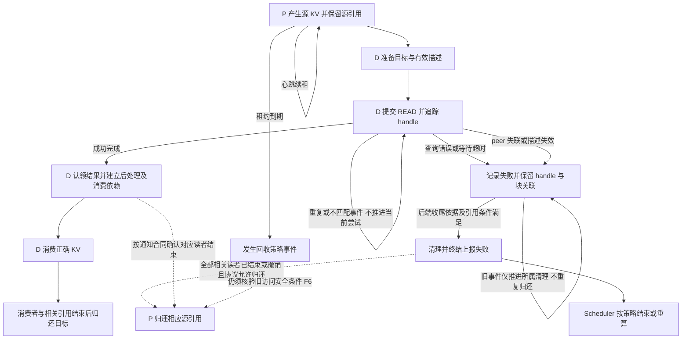
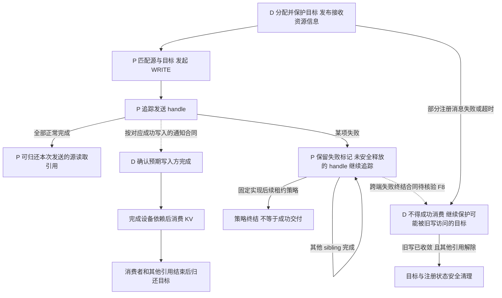

# PD/KV 故障矩阵与测试设计

基线：vLLM `d7ada3aace051fecec553c185225db2259c2ac6a`，以已核验的 PULL 路径为主。本稿只整理源码、测试规格与拟议设计；没有执行测试，也没有 GPU/RDMA 实测。下列“现有断言”与“建议补充”分别记账。

本文件提供[Change Card 03 两分支设计](../面试准备/自我准备/ChangeCard-03-PD-KV-transport.md)共用的异常验证规格；设备直传与 Host 中转的专用数据路径检查见该卡第 7 节。 F8 用于 W3 的 PULL／PUSH 职责对照，不扩展该卡首版 PULL 的实现范围。课程范围与学习证据见[单元四账本](../计划/八周冲刺进度/W3.md#lesson-plana-jd-w3-failure-system-design)。

## 异常状态机与责任映射

以下状态名是设计层标签，用来把正常路径、故障矩阵与资源条件对应起来，不冒充源码枚举。实线表示需要维持的依赖；虚线表示跨端或底层保证仍须由实际协议验证。固定 NIXL 的租约到期上报是回收策略，不自动证明图中的旧访问已停止；PUSH 的完整失败传播同样不能仅凭本地集合推定。

### PULL

源引用与 D 的计算消费不必等到同一时刻结束，但都必须满足自己的最后一个使用者条件。peer 变化按 F4 处理：新描述建立与旧本地资源清理分别推进，不能把旧在途操作改指向新实例。

### PUSH

P 正常 WRITE 完成不等于 D 已计算完；P 的到期事件也不等于 D 已收到完整失败终结。F8 区分已有测试断言与待验证的跨端停止／失败通知合同。本卡首版选择 PULL，PUSH 图用于 W3 的职责迁移与验证对照。

## 故障矩阵

| 编号／前置与注入 | 中间禁止行为与保护条件 | 恢复及终结 | source/test 与证明边界 |
|---|---|---|---|
| F1：请求已有 handle、块关联；状态查询异常，第一次 release 也异常 | 不得因为查询失败就结束资源追踪。现有测试直接检查 finished、failed、invalid blocks 均为空及 metadata 保留；源码要求 handle 留在列表 | 下一轮 DONE、release 成功后，finished 与 failed 同时报告请求、返回相应无效块 | [失败清理源码][S1]、[释放失败测试][T1]。handle 列表内容、实际回池事件可补断言；原测试不直接验证 allocator 或 DMA |
| F2：同一请求有两个 handle；一个 ERR，另一个 PROC | 单个 handle 失败不得带着整请求提前终结。现有测试检查两结果集合和无效块为空、metadata 保留；只释放已能释放的 handle | sibling 结束后报告整请求失败；不发正常成功通知，下一轮不重复报告或返回无效块 | [失败清理源码][S1]、[sibling 测试][T2]。覆盖受控状态下的多 handle 收尾，不证明真实并发访问已停止 |
| F3：同一逻辑请求存在不同尝试，并有重复／迟到的读者通知 | 设计要求：先归属尝试，再按预期参与者判重；旧事件不计入新尝试，重复事件不重复归还引用，旧尝试清理责任仍保留 | 正确尝试的全部必要参与者结束、其他引用解除后，统一清理；不能只看原始消息数 | [PULL 通知源码][S2]、[未知通知测试][T3]。实际 PULL 按 request ID 计数，所读函数没有 attempt／sender seen-set；底层交付合同尚未核验。未知通知跳过测试不是活动请求内去重测试；不同读者也可能发送相同正文 |
| F4：同端点确认新 engine，旧请求仍引用旧 peer；另测同 engine 注册载荷变化 | 新访问使用与预期身份和注册版本相符的描述；旧本地资源不能仅因新握手成功就删除。注册代际不是请求尝试或块代际 | PULL 清理等待相应握手、请求及在途访问追踪条件；注册描述变化按对应分支重握手 | [peer 清理源码][S3]、[peer 替换测试][T4]；注册刷新另见 [注册代际源码][S5]、[注册刷新测试][T6]。测试检查本地映射、descriptor 使用及延后清理；不证明退出的远端仍保存 KV，也不证明旧 DMA 已终止 |
| F5：P 有不同 deadline 的保留条目；注入续租、未知请求及到期扫描 | 软件规格：续租不缩短期限，未知条目不复活；已续租的字典首项不能阻挡其他过期项 | `now >= expires` 的条目进入 done_sending 并退出计时追踪 | [租约源码][S4]、[心跳／到期测试][T5]。这是计时与回收策略的断言，不是访问停止断言；测试构造时钟状态不能照抄为真实单调时序 |
| F6：旧访问在期限内提交，续租未及时处理；访问可能跨过到期点 | 待验证安全性质：不得把本地到期结果当成旧访问已结束的证据。必须观察实际访问、权限／隔离状态与地址复用 | 取得后端定义的停止／收敛依据，或隔离旧区域并等待安全收尾，再归还相关引用 | [租约源码][S4]、[迟到通知文档][D1]。现有 timer 测试不覆盖此性质；需补受控集成及实际后端验证。双向 turn-2 的读前 expiry 检查不能泛化为全部普通 P→D 读取 |
| F7：worker 按合同报告失败接收；分别配置 fail／recompute | 调度器不得把失败 KV 当作成功加载继续消费。重算策略也不能取消或迁移旧在途操作 | 本例 fail 路径错误结束并恢复块池数量；请求级 recompute 路径清零计算进度并重新调度 | [调度器失败处理][S6]、[恢复策略测试][T7]。验证调度恢复策略；默认 fail。按无效块恢复的其他路径不能由此一概推断为全部重算，底层清理前提仍需独立验证 |
| F8：PUSH 对照：D 注册信息可能已部分送达并触发写入；P 的一项 WRITE 失败、其他 sibling 仍在途 | D 不得仅因另一条注册消息失败或 watchdog 删条目就复用目标；P 保留未安全结束的 handle，失败不能被后续 sibling DONE 洗成成功 | 固定 P 侧失败请求保留租约，后续到期走策略终结；完整的跨端失败传播及 D 目标安全收尾仍需核验 | [PUSH worker][S7]、[注册 watchdog][S8]、[发送失败测试][T8]、[watchdog 测试][T9]。只证明所列本地控制规则，不补出不存在的 failed_sending 字段，不证明旧 WRITE 已停止 |

## 一个可执行的 B 级测试设计

**目标与范围。**针对 F1，连接固定 worker、可控软件访存队列及单槽资源池模型，验证中间保护与最终收尾。它是拟新增的受控集成设计，不是已存在或已运行的测试，也不代替真实 scheduler／RNIC 集成证明。

**Fixture。**以 [recv_worker fixture][T0] 的 `recv_worker` 为构造参考，做一个单块变式：非 HMA，请求 R，handle 101，目标 T 对应块 ID 1，metadata 的 `local_block_ids=([1],)`，本用例 `remote=None`，只测试本地接收清理。将原 fixture 的 `request` 条目替换为 R，仅保留该请求，接收 handle 列表为 `[101]`；预置 `_pending_recv_notifs["R"] = [("producer", b"R:1")]`，核对失败时丢弃待通知项而不发送成功通知。因此预期无效块集合是 `{1}`，与原测试的三块输入分别陈述。

S、T 各取 4096 byte 软件缓冲区，S 填 `0xA5`，T 已分配给 R，除此没有其他 T 使用者。队列只有显式 `advance_io` 才读 S、写 T；状态查询、释放返回及独立 P 端租约桩分别控制。单槽池占用时拒绝新分配；安全收尾后复用 T 并写入 `0x5A`，再排空剩余事件观察残留写入。`advance_io` 是测试控制点，不是真实通信 API；这一字节缓冲模型不验证 attention 的 KV 布局。

实现时使用能导入固定 worker 与其测试依赖的环境，尚未创建或运行这个用例。该 fixture 只服务于已记录失败的收尾分支；若增加正常成功对照，需要另行准备合法 remote metadata，不能直接沿用 `remote=None`。

**可重复事件顺序。**使用事件序号及可控时钟，不靠 sleep 猜竞态：

1. 提交并受理操作，保持访存队列未推进；处理一条有效心跳，确认 P 的源保留状态已续期。
2. 让状态查询抛异常，第一次 release 抛异常，调用真实 worker 的 `get_transfer_results()`。
3. 此时尝试分配新请求，记录结果；仍不推进旧访存。
4. 显式完成该次访存，把下一次状态查询设为 DONE、release 设为成功，再查询 worker。资源池适配器收到终结结果后处理归还；它不额外替 worker 隐藏提前终结。
5. 再次轮询，复用 T 并写入新模式，耗尽模型中剩余事件，检查没有旧写或旧结果重复生效。

**必须观察及断言。**记录 `(请求、handle、块、分配代际、事件序号)`，同时观察返回集合和资源池事件：

- 步骤 2–3：handle／块关联与必要引用保留，T 没有回池或分给新请求；finished、failed、无效块结果与该固定失败路径的预期一致，不能发布成功可消费。心跳续期记录不代替访存结束记录。
- 步骤 4：只有指定访问已经结束、release 成功后才允许收尾；报告 finished＋failed，成功通知不发送，待通知项与追踪清除，T 成功归还一次。第一次失败、第二次成功的两次 release 调用，不等于两次成功归还。
- 步骤 5：终结上报不重复，引用不重复归还，无遗留 handle／metadata；T 的新模式不被残留模型写入覆盖。最终集合正确不能替代步骤 2–3 的中间断言。
- 测试退出时确认队列为空并释放测试资源；异常退出也由 harness 收尾，不把测试自身泄漏误认为被测逻辑结果。

**判据与边界。**任一中间保护或最终收敛断言不满足即失败；通过仅支持该受控模型下的逻辑；本用例不替代 F3 的重复通知注入。真实 RNIC 的取消、停止访问、完成与可见性仍需对应版本的合同及设备层证据。没有可靠停止手段时，应明确“无法保证安全复用”，不能把无限等待伪装成恢复成功，也不能用更长 TTL 代替证明。

[S1]: https://github.com/vllm-project/vllm/blob/d7ada3aace051fecec553c185225db2259c2ac6a/vllm/distributed/kv_transfer/kv_connector/v1/nixl/base_worker.py#L3199-L3499
[T1]: https://github.com/vllm-project/vllm/blob/d7ada3aace051fecec553c185225db2259c2ac6a/tests/v1/kv_connector/unit/test_nixl_connector.py#L4527-L4545
[T2]: https://github.com/vllm-project/vllm/blob/d7ada3aace051fecec553c185225db2259c2ac6a/tests/v1/kv_connector/unit/test_nixl_connector.py#L4503-L4524
[S2]: https://github.com/vllm-project/vllm/blob/d7ada3aace051fecec553c185225db2259c2ac6a/vllm/distributed/kv_transfer/kv_connector/v1/nixl/pull_worker.py#L650-L701
[T3]: https://github.com/vllm-project/vllm/blob/d7ada3aace051fecec553c185225db2259c2ac6a/tests/v1/kv_connector/unit/test_nixl_connector.py#L2165-L2187
[S3]: https://github.com/vllm-project/vllm/blob/d7ada3aace051fecec553c185225db2259c2ac6a/vllm/distributed/kv_transfer/kv_connector/v1/nixl/base_worker.py#L3923-L3985
[T4]: https://github.com/vllm-project/vllm/blob/d7ada3aace051fecec553c185225db2259c2ac6a/tests/v1/kv_connector/unit/test_nixl_connector.py#L3420-L3596
[S4]: https://github.com/vllm-project/vllm/blob/d7ada3aace051fecec553c185225db2259c2ac6a/vllm/distributed/kv_transfer/kv_connector/v1/nixl/base_worker.py#L3352-L3395
[T5]: https://github.com/vllm-project/vllm/blob/d7ada3aace051fecec553c185225db2259c2ac6a/tests/v1/kv_connector/unit/test_nixl_heartbeat.py#L156-L257
[D1]: https://github.com/vllm-project/vllm/blob/d7ada3aace051fecec553c185225db2259c2ac6a/docs/features/nixl_connector_usage.md#L457

[T0]: https://github.com/vllm-project/vllm/blob/d7ada3aace051fecec553c185225db2259c2ac6a/tests/v1/kv_connector/unit/test_nixl_connector.py#L2501-L2538
[S5]: https://github.com/vllm-project/vllm/blob/d7ada3aace051fecec553c185225db2259c2ac6a/vllm/distributed/kv_transfer/kv_connector/v1/nixl/pull_worker.py#L127-L155
[T6]: https://github.com/vllm-project/vllm/blob/d7ada3aace051fecec553c185225db2259c2ac6a/tests/v1/kv_connector/unit/test_nixl_connector.py#L3725-L3731

[S6]: https://github.com/vllm-project/vllm/blob/d7ada3aace051fecec553c185225db2259c2ac6a/vllm/v1/core/sched/scheduler.py#L3432-L3445
[T7]: https://github.com/vllm-project/vllm/blob/d7ada3aace051fecec553c185225db2259c2ac6a/tests/v1/kv_connector/unit/test_kv_load_failure_recovery.py#L38-L70

[S7]: https://github.com/vllm-project/vllm/blob/d7ada3aace051fecec553c185225db2259c2ac6a/vllm/distributed/kv_transfer/kv_connector/v1/nixl/push_worker.py#L734-L847
[S8]: https://github.com/vllm-project/vllm/blob/d7ada3aace051fecec553c185225db2259c2ac6a/vllm/distributed/kv_transfer/kv_connector/v1/nixl/push_scheduler.py#L303-L327
[T8]: https://github.com/vllm-project/vllm/blob/d7ada3aace051fecec553c185225db2259c2ac6a/tests/v1/kv_connector/unit/test_nixl_push_connector.py#L984-L1050
[T9]: https://github.com/vllm-project/vllm/blob/d7ada3aace051fecec553c185225db2259c2ac6a/tests/v1/kv_connector/unit/test_nixl_push_connector.py#L294-L327
