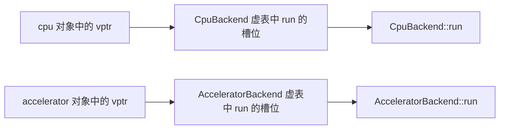
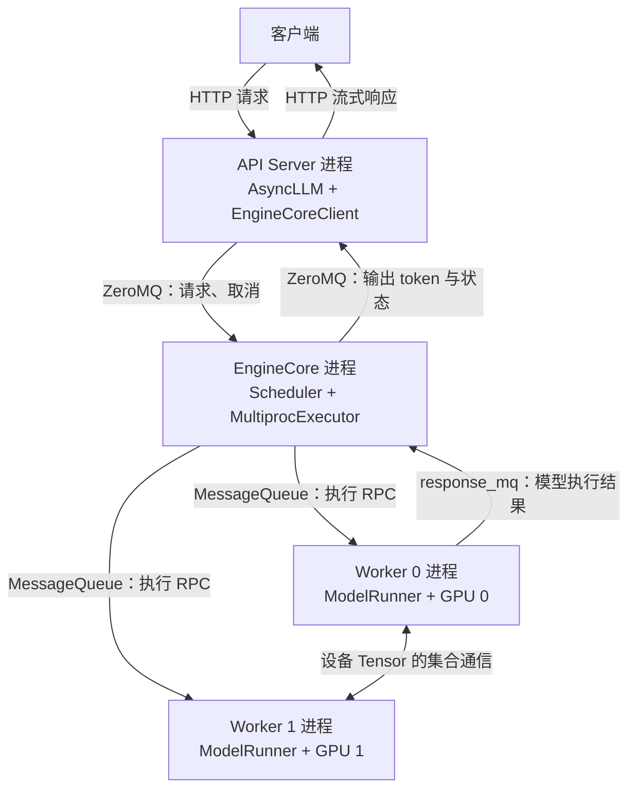

# 寒武纪面试复盘回答

- 面试日期、轮次：未确认；2026-09-08 是原分析与归档日期，不作为面试日期。
- 整理日期：2026-11-08；第 2–16 节及关联扩展题更新于 2026-11-14；第 15 题示例、第 17 题、扩展口述及反问范围调整于 2026-11-15。
- 优先来源：[ASR 校准版报告](../分析成果/reports/interview-cambricon-recording-01-asr-calibrated-analysis.md)、[逐题对照与撤回判断](../分析成果/analysis/interview-cambricon-recording-01.asr-gemini-comparison.md)、[OpenAI 原文索引](../分析成果/transcripts/interview-cambricon-recording-01.openai-asr-indexed.md)。旧 Gemini 底稿只作比较，不覆盖较新的修订。
- 证据边界：两种模型使用同一完整音频，但没有人工回听。ASR 没有时间戳或说话人字段；P001–P027 是机械文本段，不是对话轮次或精确音频位置。题意和角色按上下文恢复，专名错识继续保留不确定性。
- 覆盖范围：原 Q1–Q16 与补充 Q15b，共 17 个导航条目；Q1 只保留岗位范围确认，自我介绍正文暂缓。原 Q17 反问环节不纳入统一参考回答，按每家公司具体岗位独立准备。末尾另有 9 项扩展回答。
- 校准原则：不再认定本人漏掉 Conv3D 三通道；也不把 Gemini 补齐的 vptr、GIL 或通信 API 计为现场已经讲清。
- 项目素材来自[自我准备材料](../../自我准备/)，后补事实与现场陈述分别标注；不要求重新回忆项目，不启动课程或测验。

## 问题导航

| 本文题号 | 主题 | 原编号与 ASR 定位 |
| --- | --- | --- |
| 1 | [岗位范围确认](#cb-q1) | Q1，P001–P004；自我介绍暂缓 |
| 2 | [vLLM 适配：项目贡献与硬件平台插件](#cb-q2) | Q2，P004–P006 |
| 3 | [模型适配：Qwen2.5-VL 项目](#cb-q3) | Q3，P007–P008 |
| 4 | [Conv3D 布局与协作边界](#cb-q4) | Q4，P009–P011 |
| 5 | [异步 H2D 概率性异常的定位与修复](#cb-q5) | Q5，P011–P014 |
| 6 | [PyTorch 插件化与 Dispatcher](#cb-q6) | Q6，P014–P016 |
| 7 | [ProcessGroup 与通信流](#cb-q7) | Q7，P017–P018 |
| 8 | [C++ 多态与继承](#cb-q8) | Q8，P019 |
| 9 | [虚函数与虚表](#cb-q9) | Q9，P019 |
| 10 | [构造函数与析构函数能否为 virtual](#cb-q10) | Q10，P019–P020；析构对比为补充准备 |
| 11 | [存储期、堆栈与全局变量](#cb-q11) | Q11，P020 |
| 12 | [Python 装饰器](#cb-q12) | Q12，P020 |
| 13 | [Monkey Patch 与导入绑定](#cb-q13) | Q13，P021–P023 |
| 14 | [Python 多线程与 GIL](#cb-q14) | Q14，P023–P024 |
| 15 | [进程间通信](#cb-q15) | Q15，P024 |
| 16 | [C++ 多线程经验与基本设计](#cb-q15b) | Q15b，P024 |
| 17 | [换工作的原因与诉求](#cb-q16) | Q16，P024–P025 |
| 扩展 | [9 项扩展问题与参考回答](#cb-extra) | 补充准备，不是现场已问 |

<a id="cb-q1"></a>

## 1. 岗位范围确认

### 1.1 现场交流与处理范围

候选人将岗位理解为 AI 推理框架，面试官澄清是深度学习框架，见 [P001](../分析成果/transcripts/interview-cambricon-recording-01.openai-asr-indexed.md#p001)。随后自我介绍暂缓，不在这里改写。岗位名称相近不代表工作层次完全相同，也不据这一段认定正式 JD 的全部职责。

### 1.2 更好的回应

原答确认了框架方向，但可以先澄清本次岗位的主要层次，减少后续只围绕 vLLM 准备的偏差。

> 明白，这次是深度学习框架方向。我想先确认主要范围：更侧重 PyTorch 设备后端、算子分发和运行时接口，还是上层推理框架接入？我的具体经历可以按相关模块展开，自己负责与协作完成的部分会分别说明。

这是对现场岗位确认的改进，不补写自我介绍，也不预先假定团队只做训练或只做推理。

<a id="cb-q2"></a>

## 2. vLLM 适配：项目贡献与硬件平台插件

### 2.1 问题与复盘取舍

面试官问“vLLM 适配中做了什么”，现场原答见 [P004–P006](../分析成果/transcripts/interview-cambricon-recording-01.openai-asr-indexed.md#p004)。本人于 2026-11-14 确认没有细粒度前缀缓存项目，本节放弃该方向答法，改用以下两个方向准备：

1. **现有项目中的框架贡献**：先说明在既有插件中的职责，再以 GLM-5.3-Flash 为例，讲清业务模型接入怎样推动平台能力完善。这是回答本人经历的首选。
2. **通用硬件平台插件的设计**：沿一轮推理说明各适配层怎样配合，适合回答“如果接入新硬件，会怎样做”。这是通用设计回答，不将既有团队的平台框架写成本人从零搭建。

以下使用当前项目事实准备新的回答，不倒填为本场面试时已经完成或已经讲出的内容。

### 2.2 方向一：从业务模型接入讲框架与插件能力贡献

开场按“职责范围 → 平台能力缺口 → 具体修改 → 交付与复用价值”展开。优先讲清线性注意力状态管理这一条主线，其他 OOM、Graph 和异步执行案例按追问展开。

#### 参考回答

> 我主要负责自研芯片上 vLLM 的模型与框架适配，在既有硬件平台插件中完善模型执行、缓存管理和后端执行能力。业务模型接入是一个重要入口：接入过程中遇到的问题，有些属于模型本身，有些反映的是平台插件缺少对某一类结构或执行方式的支持，我会把其中共性的部分补充到插件里。
>
> 比如在 GLM-5.3-Flash 的适配中，除了权重映射和算子接入，我还完善了插件对线性注意力状态缓存的支持。它同时涉及卷积状态、递推状态和其他 Attention 缓存，需要把缓存分组、容量核算、实际分配以及执行时的状态访问衔接起来。
>
> 其中一个具体问题是，卷积状态和递推状态打包后形成非连续 view，在当时的后端路径上触发了很重的 Host 搬运。我通过 Profile 和隔离对照定位原因，将两类状态拆成连续池，并调整对应的访问和迁移逻辑。
>
> 这些工作支撑了当前模型的 TP8 文本版本交付，也为后续接入具有类似状态结构的线性注意力模型提供了可复用的基础。我负责插件和框架侧的适配、问题定位与验收，融合 Kernel 由算子团队实现，正式生产部署由云服务团队完成。

这里用“线性注意力状态缓存”指明对象包含卷积历史与递推状态，避免把所有状态都理解为普通 Attention 中逐 token 保存的 K/V。复用价值来自状态管理机制及后端实现经验；具体模型的状态规格、更新计算和缓存组合仍需分别适配，详见扩展题 E8。

#### 衍生问题与回答要点

| 可能追问 | 回答要点 |
| --- | --- |
| 为什么一个 view 会导致性能问题？ | view 本身通常不搬数据。打包布局让同一种状态跨 block 不连续，后续消费者在当时的后端路径上触发物化或 Host 搬运；需要沿实际访问路径定位。 |
| 为什么不在使用前加 `.contiguous()`？ | 每层、每步仍会付出物化成本。分配时拆成连续池，可以减少反复转换，但需要同步调整状态访问、迁移和初始化。 |
| 拆池后怎样保证结果不变？ | 保持 block ID 对应的逻辑状态不变，核对读写、gather／scatter、状态迁移和初始化，并做数值与模型回归；改变的是物理存储。 |
| 为什么上游布局在目标后端不合适？ | 比较具体路径对 stride、storage offset 和设备寻址的支持。结论限定当时的后端与算子接口，不扩大成硬件永远不能支持某种布局。 |
| 怎样证明收益来自布局？ | 用相同数据和逻辑操作对比连续池与打包 view 的隔离微基准，再用模型 Profile 确认它确实是热点。具体数字和测量条件回到项目档案。 |

项目依据：[GLM-5.3-Flash 项目档案](../../自我准备/projects/GLM5-3-flash-project.md)。若面试官偏向 PyTorch／Runtime，可继续用[异步 H2D 修复](../../自我准备/projects/vLLM-V1-async-H2D-project.md)解释 CPU 准备、拷贝提交与设备消费之间的依赖，详见本篇第 5 题。

### 2.3 方向二：制作通用的硬件平台插件

围绕“怎样接通一轮推理”组织回答，把插件发现、执行层、缓存、算子和通信串起来。以下方案假设设备已有可用的 PyTorch 后端或其他执行基础；vLLM 插件负责衔接这些能力，设备算子、内存分配与拷贝能力仍需由相应后端提供。

#### 参考回答

> 如果让我接入一个新的硬件平台，我会先固定 vLLM 版本和第一阶段支持范围，例如先完成一个文本模型的单卡 eager 推理。
>
> 插件入口负责让 vLLM 发现平台、选择设备 Worker 和对应后端。真正的适配沿一次执行展开：Worker 初始化设备并加载权重，ModelRunner 把调度结果整理成设备输入；Attention 后端根据 block table 和位置 metadata 读写 KV cache；算子与通信层完成设备计算；最后按照正确的完成依赖把结果交回框架。
>
> 我会先验证单请求的 prefill 和 decode，再逐步打开批处理、TP、前缀缓存和 Graph。每增加一种能力，都核对数值结果、缓存状态和异步生命周期，再评估性能。设备相关实现尽量通过明确的扩展点接入，同时维护目标版本的兼容性和回归。
>
> 我现有的经历主要是在既有插件框架上完成模型路径、缓存与状态管理、Graph 边界和后端问题修复。这些经历可以支撑上述设计中的具体取舍。

#### 各层适配职责

| 层次 | 需要说清的职责与接口 |
| --- | --- |
| 平台发现与配置 | 用 `vllm.platform_plugins` 注册平台；通过 Platform 配置 Worker、Attention backend 和 communicator，检查设备支持的配置。插件注册应能安全重复执行，并在所需进程中生效。 |
| Worker／ModelRunner | 初始化设备、加载模型、规划与分配缓存，把调度输出转成实际执行；根据目标平台复用或补充执行路径。 |
| Attention 与缓存 | 约定 KV 物理布局、block table、写入位置和有效长度，让 prefill／decode 正确访问缓存；混合模型还需描述各类状态的规格与分配方式。 |
| 算子与通信 | 接入目标设备实现，处理 dtype、布局、TP 分片和 collective 的完成依赖；按约定与算子、通信团队协作。 |
| Graph 与异步路径 | 保证捕获和 replay 所需的地址、形状与 padding 状态有效；动态内容按约定更新，缓冲区在异步访问结束前保持有效。 |

#### 衍生问题与回答要点

| 可能追问 | 回答要点 |
| --- | --- |
| 有 PyTorch 后端了，为什么还要适配 vLLM？ | PyTorch 后端提供设备 Tensor 和算子执行；vLLM 还包含专用 Attention、分页 KV、批处理 metadata、通信与 Graph 等设备相关路径，需要分别接通。 |
| Scheduler 要不要改？ | 先复用上游调度语义，把硬件差异放在执行后端；缓存类型、分组或资源核算假设不同时，仍可能需要扩展相关管理逻辑。GLM 的混合缓存案例可作为实际例子。 |
| 插件化后是否就没有升级成本？ | 插件化减少散落在主仓库中的修改，接口兼容、配置迁移和回归仍需维护；大量 patch 私有实现也会增加升级成本。 |
| 你具体实现了其中哪些？ | 回到方向一的已确认职责：既有插件内的模型路径、缓存与状态管理、Graph 边界及后端问题修复。平台框架、Runtime 和融合 Kernel 的归属分别说明。 |

接口参考：[vLLM 插件文档](https://docs.vllm.ai/en/latest/design/plugin_system/)，并以本地固定源码 `d7ada3aace051fecec553c185225db2259c2ac6a` 的[插件说明](../../../推理框架/references/vllm/docs/design/plugin_system.md)核对。接口名与支持范围以实际接入的版本为准，不套用到历史项目。

<a id="cb-q3"></a>

## 3. 模型适配：Qwen2.5-VL 项目

### 3.1 问题与现场细节

面试官问“在模型适配上主要做了哪些工作”。原答以 Qwen2.5-VL 等多模态模型的适配为例，介绍交通场景的图片／视频需求，并展开视觉 Encoder 中的 Conv3D OOM，见 [P007–P008](../分析成果/transcripts/interview-cambricon-recording-01.openai-asr-indexed.md#p007)。选择这个项目能够回应题意。原答还根据两卡容量作了显存估算，其中 ASR 的 KV 容量数字失真，不沿用为准确显存账本。

### 3.2 原回答的优点与不足

项目选择和从异常调用栈进入视觉路径的定位思路都可以保留。改进重点是先交代模型接入中的职责，再用一个案例串起问题、定位、修改、协作和验证，让面试官听清本人实际做了什么。显存估算只是排查线索；若追问 OOM 判断，要按每卡实际分片、缓存池、激活与临时物化核算峰值，不能由两卡总容量或权重大小直接推出一定能放下。

### 3.3 更好的回答方式与参考回答

下面按“工作范围 → 代表性问题 → 定位与修改 → 验证结果”口述。具体 Shape、展平映射和布局等价性留到第 4 题继续展开。

> 我可以用 Qwen2.5-VL 的适配举例。当时客户需要分析交通场景中的图片和视频，我们要让模型在自研芯片上运行。我主要负责 vLLM 框架侧的接入、精度对齐和性能优化。具体工作是梳理从图片和视频预处理、视觉编码器、位置编码到语言模型的执行路径，处理输入映射和设备算子调用。遇到算子不支持或者性能不合适的地方，我会提取实际输入形状，与算子同事一起确定接口和优化方案。
>
> 一个比较典型的问题是，Qwen2.5-VL-32B 在处理视频时出现了 OOM，调用栈指向视觉编码器里的 Conv3D。我先把出问题的输入形状提取出来，构造独立单例，再沿调用过程检查布局转换。为了确认显存在哪里增长，我把重排操作从 Conv3D 内部移到调用前，用 PyTorch 的显存快照对比各阶段，观察到重排后显存明显增加。
>
> 原因是当时的实现会把通道维移到最后，再生成新的存储。视觉输入只有三个通道，而目标后端对物理最内层的数据有补齐要求。这样在大量空间位置上，都要把很短的通道数据段分别补齐，产生了大量额外存储和数据搬运。
>
> 我在模型侧保留每个视觉块展平后的二维输入，并在模型初始化时按相同顺序整理权重，再把原来的维度信息传给专用 Conv3D。这样可以减少反复的小通道补齐。我负责问题复现、布局分析、模型调用和权重布局调整，算子同事负责专用 Kernel 的计算与访存实现，之后再一起验证效果。
>
> 验证分两层：先用同一份 BF16 输入和权重，对比设备算子与 CPU Conv3D 的结果，确认误差在测试容差内；再回到 Qwen2.5-VL-32B 做图片模型回归。在十个图片测例中，专用算子路径生成的 token 序列与使用 CPU Conv3D 的参考路径一致。单并发下，这组图片请求的平均首 token 延迟从分钟级降到了五秒以内，这是模型侧布局和专用算子共同修改后的结果。
>
> 视频方面，当时完成了视频形状的算子单测，视频输入的完整模型精度回归还没有覆盖。

当前项目依据：[多模态项目口述](../../自我准备/projects/multimodal-inference-project.md#project1-oral-baseline-20260902)、[Conv3D 案例卡 F1–F6](../../自我准备/projects/multimodal-inference-project.md#project1-conv3d-case-card-v1)。模型回归的十个图片测例各请求一次，使用 `temperature=0`、随机种子 `1234`；TTFT 取算术平均，从客户端发送请求计到收到首个生成 token，模型加载和预热不计入。单算子的容差验证与图片输出 token 一致是两个层次，不写成所有输入逐位一致；32B 视频优化前 OOM，没有可比较的 TTFT 基线。后补事实用于当前口述，不代替现场原话。

原始显存快照、失败分配与测试配置的待核细节，已加入[实机核查清单 C009–C010](实机核查清单.md#qwen25-vl)。

<a id="cb-q4"></a>

## 4. Conv3D 布局与协作边界

### 4.1 问题与现场子追问

本题承接 OOM，讨论如何减少补齐，并确认 RoPE、Attention 等优化是否也由本人定位、算子同事实现。[P010](../分析成果/transcripts/interview-cambricon-recording-01.openai-asr-indexed.md#p010)明确包含 `3×14×14×2=1176`，三通道并未漏掉。不能沿用旧 Gemini 的 392 与一千多混用来判本人计算错误。

### 4.2 原回答的优点与不足

原回答已经给出完整的窗口维度，也说明了与算子同事协作的方式。口述时可以进一步讲清两个关键点：原始输入本来就按视觉块展平，修改主要是避免后续生成通道末置的新存储；输入和权重必须使用相同的展平顺序。元素个数、物理字节数与对齐要求分别说明，片内布局和计算细节按实际掌握程度回答。

### 4.3 布局调整的口述回答

承接第 3 题的定位结果，直接解释修改怎样减少补齐，再说明数学语义与正确性验证。

> 这个 Conv3D 用来做视觉部分的 patch embedding，也就是把每个视觉块转换成后续网络使用的特征。以这次 Qwen2.5-VL 的输入为例，每个视觉块有三个通道、两个时间位置，空间大小是十四乘十四，合起来是一千一百七十六个元素。原始输入已经按视觉块展平成二维，每一行对应一个视觉块。
>
> 原来的处理路径先用 view 把它解释成五维，再在 Conv3D 内部生成通道末置的新存储。view 本身没有复制那块大数据，显存膨胀发生在后面的重排和补齐：每一个时间、空间位置上，都要对只有三个通道的数据段单独补齐，这种额外开销被重复了很多次。
>
> 我的修改是保留原来的二维输入，沿用二维的 Host 到设备拷贝路径，让专用 Conv3D 直接接收这个布局。同时，在模型初始化时，把每个输出通道对应的卷积权重也按相同顺序展平，再把原来的通道数、时间和空间维度传给算子。这样，输入和权重两侧都可以省掉通道末置的新存储。
>
> 补齐仍然存在，不过现在按每行一千一百七十六个元素的长维度处理，避免了对大量只有三个元素的小段分别补齐。这里一千一百七十六说的是元素数，实际存储还要结合数据类型和后端的字节对齐规则计算。
>
> 正确性上，关键是输入和权重按照同样的通道、时间、行、列顺序展开，让每个输入元素仍然对应原来的权重元素。模型侧调整的是数据表示，卷积计算由专用算子按约定完成。我用同一份 BF16 输入和权重对照 CPU Conv3D，比较前把 CPU 输出末尾三个大小为一的维度去掉，再核对数值误差，之后回到模型做图片回归。

### 4.4 现场追问：RoPE、Attention 等优化也是协作完成的吗？

> 对，整体上是框架侧和算子侧协作完成的。我主要从模型运行中的精度、显存和性能问题入手，提取真实输入形状，分析调用链和数据布局，再与算子同事确定接口和方案。算子同事负责 Kernel 内部的计算和访存实现，我负责框架侧的调用适配、接入以及回归验证。
>
> 以 Conv3D 为例，我实际修改了模型侧的输入处理和调用逻辑，也调整了模型初始化时的权重布局，并参与了接口设计和验证。RoPE、Attention 也是按具体任务分工，讲到某个优化时，我会分别说明自己改了哪些框架代码、算子同事实现了哪些部分。

项目依据：[Conv3D 案例卡 F3–F6](../../自我准备/projects/multimodal-inference-project.md#project1-conv3d-case-card-v1)。当前方案针对已列明的视觉块输入与卷积配置，不能推广为任意 Conv3D 都能仅靠 reshape 替代。单算子容差、图片模型回归及联合性能结果沿用第 3 题的范围；没有独立证据时，不把布局和 Kernel 的收益分开归因。算子内部的 SRAM 布局与计算实现由算子团队负责，现有材料未恢复“片内重新调整形状”的具体实现。

Conv3D 的完整接口与适用条件、RoPE／Attention 各项改动的个人归属，分别列入[实机核查清单 C011](实机核查清单.md#c011)和[C012](实机核查清单.md#c012)。

<a id="cb-q5"></a>

## 5. 异步 H2D 概率性异常的定位与修复

### 5.1 问题与原回答

面试官要求展开并发时偶发输出异常的定位。ASR 支持调整异步程度后异常减少、Host Padding 与 H2D 两阶段，以及对应拷贝尚未提交而等待先完成的描述，见 [P011–P014](../分析成果/transcripts/interview-cambricon-recording-01.openai-asr-indexed.md#p011)。本次参考回答按明确的数据依赖说明修复，现场原话保留在转写中。

### 5.2 原回答的优点与不足

原回答已经讲出调整异步程度的对照，以及 CPU Padding 与设备拷贝之间的依赖缺口。改进重点是把异常现象、定位线索、根因与最终修复分别讲清：关闭异步后异常消失支持缩小调查范围，完整依赖分析才解释了为什么出错。修复方案分成 Host 准备／提交完成和设备拷贝完成两步；具体通知、事件接口与缓冲生命周期继续核查。固定 seed 和 temperature 也不能单独证明所有底层路径确定性。

### 5.3 定位与修复的口述回答

按“异常现象 → 重放与对照 → 依赖缺口 → 修复 → 恢复异步后的回归”展开，先把问题讲完整，再回答具体同步接口的追问。

修复段采用 2026-11-14 确定的方案：由 C++ 后端管理异步准备任务，在消费 Kernel 入队前检查输入依赖，先确认准备与提交完成，再建立设备流等待。Padding 线程位于 C++ H2D 实现内部这一点已由本人确认；具体任务关联、检查入口和事件接口与历史代码的对应关系仍待 C013 核查。回归数字沿用原项目已确认记录，不作为新增实现已验证的证据。

> 这个问题发生在 Qwen3-32B 使用 vLLM V1 的时候。自研后端启用较高程度的异步拷贝后，客户现场低概率出现乱码、空回复和重复输出。我主要负责请求重放、问题定位、框架和后端层的修复，以及修复后的验证。
>
> 我先用现场收集的异常请求做重放，固定输入和生成参数，尽量减少采样随机性的干扰。对重复执行时输出不同的请求，我先找第一个分叉的 token，再比较对应的 logits 和中间 Tensor，避免把后面不断传播的差异当成最初原因。
>
> 排查中有一个线索：加入较多 Tensor Dump 后，异常反而不容易复现了。我怀疑诊断操作改变了执行时序，就进一步用开关分别控制不同的拷贝路径。单独把异步 H2D 改为阻塞后，重放中的异常也消失了。这个结果可以作为现场的临时规避方案，同时让我把排查范围收窄到输入准备、拷贝提交和消费之间的依赖。
>
> 后来确认，这条 H2D 路径实际上分成两段：后台任务先在 CPU 上把原始 Tensor 补齐成符合后端布局要求的临时 Tensor，然后才把这块数据异步拷贝到设备。原来的消费者只等待设备拷贝流，等待范围没有覆盖前面的 CPU 准备和 H2D 提交。
>
> 这样就存在一个时间窗口：CPU 还在做 Padding，对应的 H2D 尚未提交，消费者已经开始等待设备流。设备流里此前的任务完成后，等待就可能返回，但真正需要的那次拷贝还没入队。消费者随后开始读取设备数据，就可能读到尚未完整写入的内容。CPU 准备和下游执行的相对速度会变化，所以这个问题表现为概率性的异常。
>
> 修复方案是在后端把异步准备任务和后续消费关联起来。Padding 线程由 H2D 的 C++ 实现内部启动，所以任务完成状态也由后端维护。拷贝接口返回前，先登记目标数据对应的待完成任务；后台完成 CPU Padding、提交 H2D，并在拷贝流上记录完成事件后，再把任务标记为“已提交”。
>
> 后续准备提交计算 Kernel 时，Host 侧的后端提交代码先检查输入是否关联待完成任务。如果 Padding 还没完成、H2D 尚未提交，就先等待准备和提交完成，这时消费 Kernel 还不能入队。取得已经记录的拷贝完成事件后，再让计算流等待这个事件，随后提交消费 Kernel。设备拷贝可以仍在进行，CPU 不必一直等到 DMA 完成。
>
> 这样，第一段等待解决 CPU 准备和 H2D 提交的问题，第二段等待解决设备拷贝与计算的顺序问题。检查可以统一放在后端的算子提交或依赖管理入口，并处理输入的别名关系；同时保护好源数据、Padding 临时缓冲和设备目标，直到各自最后一次异步访问结束。
>
> 验证时，我恢复了原先会触发异常的异步配置，撤掉临时阻塞和额外的诊断等待，再把现场收集的一百六十八条请求连续重放五轮，共八百四十次执行，没有再观察到原来的异常。这能支持修复在这批请求和配置下有效，性能代价和更长期的覆盖还需要对应记录来说明。

### 5.4 进一步追问的口述回答

以下是补充准备，不作为现场已经问出的独立题目。

**关闭异步后就正常，为什么还不能直接认定根因？**

> 改成阻塞会改变执行时序，也可能同时掩盖不同的依赖问题，所以这个对照只能帮助缩小范围。这次进一步确认的是：CPU Padding 还没完成时，H2D 尚未提交，而消费者的等待已经可能返回。最终修复补上了这段依赖，并在恢复异步、撤掉临时等待后重新验证。

**为什么加日志或 Dump 后问题可能消失？**

> 诊断操作本身也会占用时间，有些回读还可能引入等待，原来容易撞上的时间窗口就可能改变。这次 Dump 后异常消失，是提示我检查时序的线索。验证修复时，需要撤掉额外的诊断等待，再回到原来的异步配置检查。

**固定 temperature 和 seed，是否就应该每次结果完全一致？**

> 这只能帮助减少采样随机性的干扰，不能单独证明整条执行链完全确定。我会把输出分叉当作排查入口，继续比较 logits、中间数据和执行依赖。本案例的判断依据是后续发现的准备与提交依赖缺口，以及修复后的回归结果。

**已经有设备 Event，为什么还需要 Host 通知？**

> 因为设备 Event 只能覆盖它记录时已经提交的工作。如果后台还在做 CPU Padding，拷贝和事件都没提交，消费者就开始等待，仍然可能漏掉真正需要的工作。所以先通过 Host 交接确认准备完成、H2D 和事件已经提交，再让计算流等待设备事件。前一个通知保证等待对象已经建立，后一个事件保证数据真正拷贝完成。

**输入依赖是在 Kernel 里面检查，还是提交时检查？**

> 在 Host 侧准备把 Kernel 放入设备流之前检查。后台还在 Padding 时，后端先等任务进入已提交状态，消费 Kernel 还没有入队；等拷贝完成事件已经记录，再提交设备流等待和计算。如果消费 Kernel 已经入队甚至开始执行，之后补一个等待就来不及了。这个检查可以放在公共提交入口，不需要每个 Kernel 都手写一遍，但后端需要真正接入检查逻辑，普通 PyTorch 算子不会自动识别自定义标记。

项目依据：[异步 H2D 案例卡 F1–F6](../../自我准备/projects/vLLM-V1-async-H2D-project.md#vllm-v1-async-h2d-case-card-v1)。168 条请求重放 5 轮是同一请求集的重复执行，不是 840 个独立场景；修复前同条件异常次数未恢复，不计算故障率下降幅度。此项目与异步 D2H 新能力实现分开，不借用后者的并行配置、dtype、性能或生命周期实现。

项目已确认的实现概述是框架／后端层补齐 Padded Tensor 的异步标记与等待，并复用已有 Runtime 能力。两步方案与该实现的对应关系、缓冲生命周期及回归配置，已列入[实机核查清单 C013–C015](实机核查清单.md#async-h2d)。

<a id="cb-q5-sync"></a>

### 5.5 Python 层的同步方式与使用场景

选同步方式时，先明确“谁在等待、等待哪个完成条件”。本案例包含三种关系：CPU 等后台准备任务、设备计算流等拷贝流、CPU 等设备结果。三者需要分别建立依赖。

下面用 Python 线程接口和 PyTorch CUDA 接口说明。Stream／CUDA Event 是设备后端通过 Python 暴露的能力；自研后端是否提供同名接口、是否覆盖 Host 任务，需要核对实际实现，不能直接套用 CUDA 行为。

#### 5.5.1 设备执行相关的同步

| 方式 | 谁等待什么 | 适用场景 | 关键边界 |
| --- | --- | --- | --- |
| 同一条 stream 按顺序提交 | 后提交的设备操作按流内顺序执行 | H2D 和消费它的计算已依次提交到同一条流 | 通常不需为这两个操作额外阻塞 CPU；仍需保证 Host 数据已准备好、提交顺序正确。 |
| `torch.cuda.synchronize(device)` | 调用它的 CPU 线程等待指定设备各流的工作完成 | 排错、建立同步基线、明确设备计时边界 | 范围较大，会影响重叠；不是所有设备的全局屏障，也不等待尚未向设备提交工作的 CPU 任务。 |
| `stream.synchronize()` | CPU 线程等待这条流的工作完成 | Host 需要确认某条执行路径已经完成 | 比设备同步范围小；不能保证后台线程未来才提交的 H2D 已被覆盖。 |
| `event.synchronize()` | CPU 线程等待事件记录位置及其依赖完成 | 异步 D2H 后，CPU 要读取 Host 输出；或确认某次拷贝结束后复用缓冲 | Event 应记录在目标操作之后；不必等待该流在 Event 之后的无关工作。 |
| `consumer.wait_event(event)`／`event.wait(consumer)` | consumer 流后续提交的工作等待事件 | H2D 在拷贝流，计算在另一条流；希望保持 CPU 继续提交工作的能力 | 不因等待该事件而阻塞 CPU；不影响 consumer 已经提交的操作。 |
| `consumer.wait_stream(producer)` | consumer 后续工作等待调用时 producer 中已提交的工作 | 跨流交接，所需生产任务已全部提交，不必保存显式 Event | 是调用时的依赖边界，不是两条流永久绑定；producer 之后再提交的工作不会自动纳入。 |
| `event.query()`／`stream.query()` | CPU 查询完成状态，不等待 | 调度器轮询、检查任务能否回收 | 返回布尔值本身不会建立后续消费依赖；必须判断结果，并确认查询对象覆盖目标任务。 |

接口依据：本地 PyTorch `0bd89deb431509d893177a84cfa4768aa0399809` 的[Stream／Event 实现](../../../PyTorch/references/pytorch/torch/cuda/streams.py)、[设备同步实现](../../../PyTorch/references/pytorch/torch/cuda/__init__.py)及[CUDA 执行语义](../../../PyTorch/references/pytorch/docs/source/notes/cuda.md)。公开接口可对照 [PyTorch 2.9 Stream](https://docs.pytorch.org/docs/2.9/generated/torch.cuda.Stream.html)、[Event](https://docs.pytorch.org/docs/2.9/generated/torch.cuda.Event.html)与[设备同步](https://docs.pytorch.org/docs/2.9/generated/torch.cuda.synchronize.html)。

最容易混淆的是 `event.wait()` 与 `event.synchronize()`：对于 **CUDA Event**，前者向设备流添加等待，后者让当前 CPU 线程等到事件完成。CPU 要读取异步 D2H 的结果时，应使用完成后的确认，例如在 D2H 后记录事件并调用 `event.synchronize()`；仅给另一条设备流添加等待，不能保证 CPU 此刻读到完整结果。

#### 5.5.2 CPU 线程之间的同步

| 方式 | 适用场景 | 对本案例意味着什么 |
| --- | --- | --- |
| `concurrent.futures.Future.result()`／`Thread.join()` | 等后台任务返回或线程结束；Future 还能获取结果并传播任务异常 | 如果任务只负责 Padding，返回只说明 Padding 完成；如果还负责提交 H2D，返回可以说明已提交，但不自动代表 DMA 完成。 |
| `threading.Event.wait()` | 等待另一线程通过 `set()` 发布状态 | 适合表示“准备完成”或“拷贝与事件已提交”；状态含义由生产者在什么位置 `set()` 决定。带超时时需检查返回值。 |
| `Condition.wait_for(predicate)` | 等共享状态满足条件，例如队列非空或任务进入指定阶段 | 持锁检查条件；等待期间释放锁，唤醒后重新取得锁并检查。通知本身不替代条件成立。 |
| `Lock`／`RLock` | 保护任务表、计数或缓冲池等共享 CPU 状态 | 保证临界区互斥，不会自动等 GPU；解锁不表示临界区里提交的设备任务已经完成。 |
| `Semaphore` | 限制同时占用缓冲或执行任务的数量 | 适合控制在途任务数；归还名额应与资源实际可复用的时点一致。 |
| `threading.Barrier` | 固定数量的 CPU 线程在某个阶段会合 | 各线程到达屏障，不代表各自提交的设备任务已经完成。 |

依据：[Python 3.13 线程同步接口](https://docs.python.org/3.13/library/threading.html)与[Future 的完成语义](https://docs.python.org/3.13/library/concurrent.futures.html#concurrent.futures.Future.result)。`threading.Event` 的等待阻塞 CPU 线程，与上面的 CUDA Event 不同；两者虽然都叫 Event，表达的完成条件并不相同。

#### 5.5.3 在这次 H2D 场景中怎样组合

本方案在 C++ 后端完成两段依赖：准备任务的状态通知保证“Padding 完成、H2D 与事件已经提交”；计算流的事件等待保证“拷贝完成后才消费”。Python 层继续使用 Tensor 接口。

**项目的封装边界。** 本人确认 Padding 线程在 PyTorch H2D 的 C++ 实现内部启动。标准 `Tensor.to()` 和 `copy_()` 返回 Tensor，不返回内部任务的 Future。只在 Python 外层再套一个线程池，Future 完成也只能说明该次 Python 调用已经返回；如果 C++ 调用早于内部 Padding 完成就返回，这个 Future 不能补上缺口。[Tensor.to 接口](https://docs.pytorch.org/docs/2.9/generated/torch.Tensor.to.html)、[Tensor.copy_ 接口](https://docs.pytorch.org/docs/2.9/generated/torch.Tensor.copy_.html)

在“拷贝接口提前返回、后端管理待完成任务”的方案中，处理顺序如下：

1. **登记任务后再返回。** C++ H2D 路径把待完成任务与目标数据关联，确保返回 Tensor 前，后续消费者已经能够发现该依赖。
2. **后台准备并提交。** 后台线程完成 Padding，向拷贝流提交 H2D，在其后记录完成事件，再发布“已提交”状态。后台任务还需要保留正确的设备与流上下文，以及异步访问所需的缓冲。
3. **消费入队前检查。** Host 侧的公共提交入口查找输入关联的任务。若准备或提交未完成，先等待该阶段；取得已记录的事件后，向计算流提交事件等待，再提交消费 Kernel。
4. **完成后回收。** 按各缓冲的最后一次访问完成条件回收或复用；后台失败应传播给等待者，不能让等待永久挂起或继续使用无效数据。

检查输入时，需要区分以下状态：

| 输入状态 | Host 侧的提交代码如何处理 | 消费 Kernel 的状态 |
| --- | --- | --- |
| Padding 或 H2D 提交尚未完成 | 等待任务发布“已提交”状态，或由任务调度器延后处理 | 尚未入队；此前已经提交的其他设备工作可以继续执行。 |
| H2D 与事件已提交，设备拷贝尚未完成 | 向计算流加入完成事件等待，再提交 Kernel | 已入队，但执行受事件依赖约束；CPU 可继续提交其他工作。 |
| 数据已就绪，或同流顺序已经保证依赖 | 可以直接提交 Kernel | 按已有的执行顺序消费数据。 |

以下是消费侧的后端伪代码，接口名仅表示职责，不是 PyTorch 自带的调用：

```cpp
// Host 侧：目标 Kernel 尚未入队。
// 这里只展示仍需建立跨流依赖的输入任务。
for (auto& task : pending_write_dependencies(inputs)) {
    auto event = task.wait_until_submitted();  // 等 Padding、H2D 和事件提交完成。
    compute_stream.wait_event(event);         // 设备流等拷贝完成，CPU 可继续。
}
launch_kernel(inputs);                       // 等待必须排在消费之前。
```

`wait_until_submitted()` 可以由 C++ future、条件变量或既有任务完成状态实现，无须向 Python 暴露 Future。它返回时，设备拷贝可以尚未完成；第二段设备依赖通过目标后端的事件机制表达。后台仍在 Padding 时，消费 Kernel 尚未入队，因此不存在“Kernel 已经执行到读取位置，再回头等待 Padding”的正常路径。

依赖管理应识别同一底层数据的相关 view／别名，并覆盖读取它的计算、拷贝及相关事件记录和同步入口。仅保存一个标记不会自动建立依赖；需要由后端提交与同步路径读取并处理。标记对应的具体对象、存储范围和清理时机仍按 C013、C014 核实。

另一种较简单的实现是让 C++ 拷贝接口在 Padding 完成、H2D 及所需依赖提交好之后才返回，DMA 仍可异步执行，但会减少调用线程与 Padding 的重叠。是否需要自定义完成句柄或等待接口，取决于后端如何组织这套协议；不改变标准 Tensor 接口就不能假定它会额外返回 Future。

有两个与原故障直接相关的边界：

- **`wait_stream()` 不能补上尚未提交的 H2D。** 若后台还在 Padding，主线程此时调用 `compute_stream.wait_stream(copy_stream)`，只建立当时已提交工作的依赖，仍可能漏掉后台稍后提交的拷贝。
- **CUDA Event 不能当作等待未来 `set()` 的线程通知。** 要先完成 `record()` 的 Host 调用，再让消费者等待它。CUDA 事件首次记录前代表空工作集；已经发出的流等待也不会被后续重新记录追溯更新。本方案通过后端的“已提交”状态完成事件发布的交接。[CUDA 12.9 事件记录规则](https://docs.nvidia.com/cuda/archive/12.9.0/cuda-runtime-api/group__CUDART__EVENT.html)

#### 5.5.4 容易误认为同步的操作

- **`with torch.cuda.stream(s)`** 选择后续操作提交到哪条流，退出代码块会恢复原流，不等于该流已经执行完。
- **`non_blocking=True`** 允许相应拷贝路径省去 Host 完成等待，不等于数据已经可读，也不保证一定与其他工作重叠。源缓冲在拷贝完成前仍需保持有效且不被改写。
- **`tensor.record_stream(s)`** 告知 PyTorch 的 CUDA 分配器，该 Tensor 还被另一条流使用，以防底层内存过早复用；它不建立生产者到消费者的数据就绪依赖，也不阻止用户主动原地改写 Tensor。它不能代替 `wait_event()`／`wait_stream()`，也不能直接用来证明 Host staging 已安全。[record_stream 文档](https://docs.pytorch.org/docs/2.9/generated/torch.Tensor.record_stream.html)
- **固定 sleep 或增加日志** 可能改变竞态的出现时机，但不能据此认定已经建立了所需的数据依赖。

前两项可对照上述固定源码的 StreamContext 与 CUDA 执行语义。真实设备完成依赖、任务登记与生命周期的实现映射继续核查 C013、C014；本节的后端伪代码说明方案职责，不作为已核验的项目实现。

#### 5.5.5 面试口述版本

> 我会先分清谁在等谁。CPU 等后台准备任务，可以用 Future、线程 Event 或条件变量；CPU 要读取设备结果，可以等具体的 CUDA Event，或者同步相关 stream。两条设备流之间有数据依赖时，我优先用 wait_event 或 wait_stream，让设备按依赖执行，CPU 可以继续提交其他工作。需要较大范围的排错或计时边界时，再考虑设备同步。
>
> 但这些等待都有范围。这次 Padding 任务在 H2D 的 C++ 实现内部，所以应由后端管理任务状态，并在消费 Kernel 入队前检查输入依赖。准备和提交没完成时，先在 Host 侧等到任务已提交；随后让计算流等待拷贝完成事件，再提交 Kernel。这样不用向 Python 暴露内部 Future，也不用让 CPU 一直等到 DMA 完成，同时还要保护相关缓冲的生命周期。

<a id="cb-q6"></a>

## 6. PyTorch 插件化与 Dispatcher

### 6.1 问题与现场子追问

本人于 2026-11-14 确认，面试官先问 PyTorch 插件化，再追问 Dispatcher 原理。原答说明直接维护主仓库导致升级冲突，项目当时仍在进行；分发解释先说 device，再补训练／推理和梯度处理。[P015–P016](../分析成果/transcripts/interview-cambricon-recording-01.openai-asr-indexed.md#p015)中的 Paddle／PyTorch 名称冲突保留在转写，当前答法按本人澄清使用 PyTorch。

### 6.2 原回答的优点与不足

插件化动机与当时进行中的边界清楚，也有按 Tensor 和设备选择实现的线索。参考回答先概述后端插件需要接入哪些能力，再用一个已定义好条件的算子说明注册、key 选择、Autograd 与 backend 的调用关系。Dispatcher 根据有效 key 集合和优先级选路；module 的 train/eval、梯度记录、dtype 和 shape 不是固定依次经过的四级分发开关。

### 6.3 PyTorch 插件化的口述回答

以下以 PrivateUse1 接入路线概述工程范围；具体项目采用的扩展点与本人已完成的部分继续按 C016 核对。

> 这项插件化工作的出发点，是降低跟随 PyTorch 上游升级的维护成本。之前设备支持直接写在主仓库里，上游更新后要处理很多代码冲突。插件化就是把设备相关实现逐步整理成可以独立安装、加载的后端扩展，尽量通过 PyTorch 提供的注册接口接入。
>
> 以 PrivateUse1 为例，我会先接好设备基础能力，包括设备初始化和选择、内存分配、Stream 和 Event，以及它们与 Runtime 的接口。接着让 Tensor 的创建、拷贝、view 和存储管理能够正确工作，特别要保持 shape、stride、别名和异步生命周期的语义。前面讨论的 H2D 准备和消费依赖，就属于这一层。
>
> 再往上是算子接入。对已经存在的 ATen 算子，沿用原来的接口定义，把设备实现注册到对应的 dispatch key，例如 PrivateUse1。设备实现负责把 PyTorch 的参数和 Tensor 布局转成算子库能够使用的形式，再提交计算。暂时不支持的算子，要明确是复用已有的组合实现、配置受控的 CPU 回退，还是直接报告不支持，并验证相应语义和性能。
>
> 根据目标范围，还要补齐随机数、序列化等能力。支持训练时，要核对 Autograd 和反向依赖的算子；支持自动混合精度时，要接好转换策略；如果还要支持分布式或 torch.compile，就继续接通信或编译相关接口。最后把这些内容组织进独立扩展包，处理加载注册、版本兼容，并从基础算子测试推进到模型回归。
>
> 所以判断插件化完成到什么程度，要看设备、Tensor、算子和目标功能是否真正接通。使用 PrivateUse1 可以减少对主仓库的修改，但插件仍然需要跟随接口变化维护，项目进度和个人职责也要按实际实现说明。

接口依据：[PrivateUse1 官方接入说明](https://docs.pytorch.org/tutorials/advanced/privateuseone.html)，以及本地 PyTorch `0bd89deb431509d893177a84cfa4768aa0399809` 的[设备管理](../../../PyTorch/references/pytorch/docs/source/accelerator/device.md)、[运行时 hooks](../../../PyTorch/references/pytorch/docs/source/accelerator/hooks.md)和[算子注册](../../../PyTorch/references/pytorch/docs/source/accelerator/operators.md)。这里概述工作范围，不声称本人已经独立实现完整后端。

### 6.4 用 `torch.add(a, b)` 讲 Dispatcher 的口述回答

固定示例条件：`a`、`b` 是同一个 PrivateUse1 设备上、形状相同的普通 dense float32 Tensor，二者需要梯度，当前开启梯度记录；没有启用 autocast、Tensor subclass 或其他特殊模式。假设插件已为 `aten::add.Tensor` 注册设备实现，所需 Autograd 与基础算子也已接通。示例用于说明机制，不作为项目已实现该算子的证据。

> 可以用 `torch.add(a, b)` 来说明。先说注册阶段：PyTorch 已经定义了这个算子的接口，也就是 schema。这里两个参数都是 Tensor，对应的是 `aten::add.Tensor` 这个重载。插件把自己的加法实现注册到这个算子的 PrivateUse1 key 上。这样同一个算子就可以有 CPU、CUDA 和自研设备等不同实现。
>
> 真正调用时，Python 入口先完成参数和重载解析，再进入 Dispatcher。Dispatcher 会提取输入 Tensor 携带的 dispatch key，并结合当前线程启用或排除的 key，形成这次调用的有效 key 集合，然后按优先级查这个算子的分发表。它看的是这次调用需要哪些处理语义，不只是看一个 device 字符串。
>
> 在这个需要记录梯度的例子里，会先进入对应的 Autograd 包装层。它准备反向传播所需的节点和信息，然后通过 redispatch 继续往下分发。继续分发时，要排除已经处理的 Autograd 层，避免又选回自己；接下来才会到插件注册的 PrivateUse1 加法实现。
>
> 设备实现拿到 Tensor 和参数后，处理所支持的类型、形状、布局以及输出分配，再调用芯片算子。这里可能根据 dtype、连续性或者形状选择不同的内部计算路径，但这是进入后端后的选择。设备实现返回输出 Tensor 后，Autograd 包装层把它与反向图连接起来，最后返回给 Python；异步后端返回 Tensor 时，设备计算不一定已经完成。
>
> 如果把输入换成 CPU Tensor，就会对应到 CPU 的处理路径；如果改变梯度模式或开启 autocast，有效 key 和包装逻辑也会变化。所以 Dispatcher 的核心是“算子注册表加上运行时的 key 集合”，不同功能层通过 redispatch 组合起来，不是一套固定的训练、设备、类型、形状四级判断。

对应的接口与注册可以简写为：

```text
aten::add.Tensor(Tensor self, Tensor other, *, Scalar alpha=1) -> Tensor
```

```cpp
// 注册示意：add_privateuse1 的实现和签名需要由插件提供。
// ATen 已有这个 schema，所以这里注册实现，不重新定义算子。
TORCH_LIBRARY_IMPL(aten, PrivateUse1, m) {
    m.impl("add.Tensor", TORCH_FN(add_privateuse1));
}
```

本例的主要调用关系如下；省略了不改变主线的跳过项：

```text
torch.add(a, b)
  → 解析为 aten::add.Tensor
  → Dispatcher：输入 key + 线程局部状态 → 按优先级选择
  → AutogradPrivateUse1 对应的包装层：准备梯度记录
  → redispatch：排除已处理的 Autograd 层
  → PrivateUse1：插件注册的加法实现
  → 设备算子提交
  → 返回输出，Autograd 包装层连接反向图
```

Autograd 包装层属于前向调用过程，此时准备反向图，并不是已经执行 backward。对内置 `add.Tensor`，可以复用上游定义的反向规则及生成包装；这不等于所有自定义算子都自动获得正确反向。新算子仍需明确 schema、设备实现，以及所需的 Autograd、Fake／Meta 等支持。

实现依据采用同一固定源码：[`add.Tensor` schema](../../../PyTorch/references/pytorch/aten/src/ATen/native/native_functions.yaml)、[key 集合提取与线程局部状态](../../../PyTorch/references/pytorch/aten/src/ATen/core/dispatch/DispatchKeyExtractor.h)、[Dispatcher 查表与调用](../../../PyTorch/references/pytorch/aten/src/ATen/core/dispatch/Dispatcher.h)、[Autograd 包装代码生成](../../../PyTorch/references/pytorch/tools/autograd/gen_variable_type.py)及[加法反向规则](../../../PyTorch/references/pytorch/tools/autograd/derivatives.yaml)。注册与 redispatch 的接口说明见[官方 Dispatcher 教程](https://docs.pytorch.org/tutorials/advanced/dispatcher.html)。

### 6.5 衍生问题与回答要点

以下是补充准备，不作为现场已问。

| 可能追问 | 回答要点 |
| --- | --- |
| 把 PrivateUse1 改成自己的设备名称，就完成插件化了吗？ | 名称只提供用户入口；设备管理、Tensor 基础操作、算子注册及目标功能仍需实现和验证。 |
| `model.eval()` 会跳过 Autograd 吗？ | eval 改变相关模块的训练／评估行为，不自动关闭梯度记录。`no_grad` 和 `inference_mode` 又有不同机制，不能仅凭是否记录反向图断言走过完全相同的 key 路径。 |
| 某个算子没注册 PrivateUse1 实现，会自动去 CPU 吗？ | 要看该算子的注册表和后端回退配置：可能有可用的组合实现或显式 fallback，也可能报不支持。CPU 回退需要相应机制，不由缺失设备实现自动保证。 |
| shape 或 dtype 变化会换 dispatch key 吗？ | 对这个普通 dense add 示例，dtype 和 shape 通常影响类型提升、检查及后端内部路径；不能把它们当成固定的独立 dispatch 层。稀疏布局等 Tensor 语义变化则可能对应不同的 key。 |

插件项目的实际范围与个人改动、目标版本中一个真实算子的注册和调用链，分别列入[实机核查清单 C016](实机核查清单.md#c016)和[C017](实机核查清单.md#c017)。

<a id="cb-q7"></a>

## 7. ProcessGroup 与通信流

### 7.1 问题与现场细节

讨论 DeepSpeed／TP 后，面试官问分布式后端，候选人主动确认是否指 ProcessGroup，见 [P017](../分析成果/transcripts/interview-cambricon-recording-01.openai-asr-indexed.md#p017)。原答说明减少独立通信流的做法；不能沿用旧稿“面试官直接给出 ProcessGroup 名称”的归属。

### 7.2 原回答的优点与不足

能联系设备执行方式与调度成本，是有价值的案例。重点说明这是根据当时硬件平台和软件栈的实际情况提供单流配置选项，以减少目标负载下不必要的调度开销。需要区分具体负载没有有效重叠与硬件永远不能并行，也不能仅凭流数量减少断言收益。ProcessGroup 还涉及参与 rank、顺序、结果、异步完成和错误语义。

### 7.3 更好的回答方式与参考回答

> 我参与的是框架与自研通信后端的适配，主要从框架测试核对 collective、分组、Tensor 布局和完成语义。ProcessGroup 提供一组 rank 上的通信接口，具体 backend 负责实际通信与异步工作；返回或提交成功不一定表示数据已经能被任意消费者使用。
>
> 项目里曾发现，在当时的硬件平台、软件栈和训练负载下，多 Stream 通信没有形成预期的计算与通信重叠，却因为频繁切换 Stream 拆散了提交批次，增加了 Event、Wait 和命令提交开销。我通过 Profile 观察执行时间线，再用单流对照检查这些开销的变化。
>
> 根据这个平台当时的执行情况，我提供了一个单流配置选项。启用时，让相关通信与计算在同一条执行流里按依赖顺序执行，减少额外的流切换、同步操作和批次拆分。修改覆盖了 PyTorch 通信适配层和通信库相关部分，同时保留多流路径，方便根据平台能力和负载选择执行方式。
>
> 我先用通信单例检查提交行为，再回到相同训练负载做端到端对照，观察到该环境中的调度与启动开销减少。这种调整仍要保持数据产生、通信和消费的顺序，并核对异步 Work 的完成与资源释放。后续如果平台和负载能够有效重叠通信与计算，就可以切回多流，再用同条件测试判断哪种方式更合适。

当前事实：[分布式项目口述](../../自我准备/projects/DeepSpeed-Megatron-project.md#project4-oral-baseline-20260903)。接口依据：[PyTorch ProcessGroup 扩展教程](https://docs.pytorch.org/tutorials/intermediate/process_group_cpp_extension_tutorial.html)；不能把参与后端适配写成独立实现整个通信 Kernel 库。

配置开关的实际作用范围、Work 语义与同条件对照记录，列入[实机核查清单 C018](实机核查清单.md#c018)。当前口述保留已确认的定性结果，不补报尚未统一的加速数字。

<a id="cb-q8"></a>

## 8. C++ 多态与继承

### 8.1 问题与原回答

面试官问多态概念，原答提到继承和函数重载，没有完成分类，随后被引向虚函数，见 [P019](../分析成果/transcripts/interview-cambricon-recording-01.openai-asr-indexed.md#p019)。提到重载不等于全错；但没有讲清它与运行时覆盖的区别。

### 8.2 更好的回答方式

先说明继承是类之间的关系，多态是同一种调用形式对应不同实现，再区分编译期选择与运行时绑定。分别用函数重载、函数模板和基类引用调用虚函数举例；继承本身不要求使用虚函数。

### 8.3 口述回答

> 我会先把继承和多态分开。继承描述的是类之间的关系，派生类可以在基类基础上扩展行为或复用成员；多态描述的是同一种调用形式，可以对应不同的实现。C++ 里通常会分编译期多态和运行时多态：函数重载、模板是编译期多态的常见方式，基于继承和虚函数的动态绑定则是运行时多态。
>
> 函数重载可以举一个打印函数的例子：我定义 `print(int)` 和 `print(double)`，它们名字相同，但参数类型不同。调用 `print(1)` 时选择整数版本，调用 `print(1.5)` 时选择 double 版本。编译器根据调用参数的静态类型和匹配规则决定调用哪个函数，不需要继承，也不需要运行时查看对象类型。
>
> 模板的例子是一个 `add_value<T>`，接收两个 T 类型的参数，再返回它们相加的结果。传入两个 int 时可以推导出 T 是 int，传入两个 double 时则推导出 T 是 double。这里复用的是同一套代码逻辑，由编译器根据类型实例化相应函数。与手动写多个重载相比，模板适合把对不同类型都成立的逻辑统一表达出来。
>
> 运行时多态可以用计算后端举例。我定义一个 Backend 基类，把 run 声明为虚函数；CpuBackend 和 AcceleratorBackend 分别继承它，并覆盖 run。上层函数只接收一个 Backend 的引用，再调用 run。虽然引用的静态类型始终是 Backend，但实际对象是 CpuBackend 时就执行 CPU 版本，是 AcceleratorBackend 时就执行加速器版本。上层可以通过同一个接口使用不同实现。
>
> 继承本身并不保证这种动态选择，关键是通过基类接口调用虚函数。派生类覆盖时我会写 override，让编译器检查签名是否正确。运行时多态的对象也应通过指针或引用传递，避免按值复制成基类时发生对象切片。

### 8.4 三个最小代码例子

以下是三个独立的 C++17 示例，各自可以编译运行；它们用于解释语言机制，不作为项目经历。

#### 8.4.1 函数重载：同名函数，参数不同

```cpp
#include <iostream>

void print(int value) {
    std::cout << "int: " << value << '\n';
}

void print(double value) {
    std::cout << "double: " << value << '\n';
}

int main() {
    print(1);    // 选择 print(int)。
    print(1.5);  // 选择 print(double)。
}
```

输出分别是 `int: 1` 和 `double: 1.5`。本例中两个调用都有精确匹配，选择在编译期完成。一般重载还需要考虑隐式转换与是否存在歧义；不能只改变返回值类型来重载普通函数。

#### 8.4.2 函数模板：同一套逻辑用于不同类型

```cpp
#include <iostream>

template <typename T>
T add_value(T a, T b) {
    return a + b;
}

int main() {
    std::cout << add_value(1, 2) << '\n';      // T 为 int，输出 3。
    std::cout << add_value(1.5, 2.0) << '\n';  // T 为 double，输出 3.5。
}
```

`T` 在这些调用中由实参类型推导，编译时检查对应类型是否支持函数体中的操作。模板实例化和函数选择发生在编译期，函数的加法计算本身仍可以发生在运行时；“编译期多态”不等于“所有结果都在编译期算好”。模板和重载也可以共同参与重载解析。

#### 8.4.3 运行时多态：基类引用调用派生实现

```cpp
#include <iostream>

struct Backend {
    virtual void run() const {
        std::cout << "Backend\n";
    }
    virtual ~Backend() = default;
};

struct CpuBackend : Backend {
    void run() const override {
        std::cout << "CPU\n";
    }
};

struct AcceleratorBackend : Backend {
    void run() const override {
        std::cout << "Accelerator\n";
    }
};

void execute(const Backend& backend) {
    backend.run();
}

int main() {
    CpuBackend cpu;
    AcceleratorBackend accelerator;
    execute(cpu);          // 输出 CPU。
    execute(accelerator);  // 输出 Accelerator。
}
```

`execute` 中引用的静态类型是 `const Backend&`，但它分别绑定两种实际对象，虚调用选择对应的最终覆盖实现。这里的 `struct` 继承默认是公有继承；换成 `class` 时，可以显式写 `public Backend` 表达同样的关系。

如果基类的 `run` 不是虚函数，派生类同名函数就不能覆盖这一虚接口；保留 `override` 会使编译器报错。若改为按值接收 `Backend`，传入派生对象时会复制出一个基类对象，派生部分被切掉，无法继续通过该对象选择原派生实现。虚表的常见实现方式留到第 9 题展开。

语言依据：[函数重载](https://eel.is/c++draft/over)、[函数模板](https://eel.is/c++draft/temp.fct)、[继承](https://eel.is/c++draft/class.derived)与[虚函数及 override](https://eel.is/c++draft/class.virtual)。这里解释机制，不据现场短暂迟疑推断从未做过 C++ 修改。

<a id="cb-q9"></a>

## 9. 虚函数与虚表

### 9.1 问题与原回答

面试官追问虚函数实现。ASR 支持提到虚函数指针表和具体实现，但没有充分展开对象 vptr 到表项的路径。Gemini 整理出的完整机制不能记为本人已经讲清。

### 9.2 更好的回答方式

沿用第 8 题的 Backend 例子，先说明基类引用调用派生实现的语言保证，再解释常见实现中“对象的虚表指针 → 虚表中对应槽位 → 函数入口”的路径。区分对象里的指针与通常共享的虚表，最后说明 ABI 布局及优化边界。

### 9.3 口述回答

> 虚函数的作用，是让我们通过基类指针或引用调用时，能够根据对象的实际类型选择对应的覆盖实现。比如刚才的 execute 函数接收 Backend 引用，再调用 run。引用绑定 CpuBackend 对象时，调用的是 CPU 版本；绑定 AcceleratorBackend 对象时，调用的是加速器版本。
>
> 常见编译器通过虚函数表和虚表指针实现这件事。虚函数表通常叫 vtable，其中有虚函数对应的入口；对象里会有编译器维护的隐藏指针，通常叫 vptr，用来找到相关虚表。对于前面这个简单的单继承例子，同一类型的完整对象通常共享对应的虚表，每个对象保存自己的指针，不需要给每个对象复制一整张表。
>
> 调用 backend.run 时，编译器已经知道 run 对应哪个虚函数槽位。常见的执行过程是先读取对象中相关基类子对象的 vptr，找到虚表，再从 run 对应的槽位取出函数入口，最后通过这个入口调用。CpuBackend 对应表里的这个槽位指向 CPU 的实现，AcceleratorBackend 对应表里的槽位指向加速器的实现。运行时变化的是对象对应的表和函数入口，并不是每次都按函数名遍历搜索。
>
> 这些是常见的二进制接口实现方式，C++ 标准保证的是动态绑定结果，没有规定所有平台都必须采用完全相同的对象布局。多重继承时，可能涉及多个虚表指针或相关表项，也可能先调整 this 指针，让函数拿到正确的对象地址。因此不能笼统地说每个对象只有一个 vptr，或者 vptr 一定在对象的第一个字段。
>
> 没有被优化掉的虚调用通常包含间接调用；如果编译器已经能确定实际目标，也可能把它优化成直接调用，甚至进一步内联。所以源码里写了 virtual，不代表最后一定会执行一次查表和间接跳转。

### 9.4 与上一题例子的对应关系

沿用[第 8 题的运行时多态示例](#cb-q8)，下面只画普通完整对象中 `run` 的概念性选路，不表示真实内存偏移、虚表完整内容或优化后的机器指令。



两次调用都从同一个 `execute(const Backend&)` 中的 `backend.run()` 发起。调用点知道要访问哪个槽位，实际对象决定读取到哪张相关虚表，从而选择对应的最终覆盖函数。

虚表并不一定只是函数地址数组。以 Itanium C++ ABI 为例，还包含类型信息和偏移等内容；vptr 指向表内约定的地址点，不一定是整张表的起始地址。函数槽位也可能指向先调整对象地址、再进入实际函数的入口。这些细节用于回答进一步追问，主口述先讲清上面的选路过程。

函数覆盖与重载的区别沿用第 8 题。若通过通常的基类指针 delete 销毁派生对象，基类需要正确的虚析构设计；对象构造／析构阶段的虚调用规则在第 10 题继续展开。

依据：[语言规则](https://eel.is/c++draft/class.virtual)、[Itanium C++ ABI 虚表说明](https://itanium-cxx-abi.github.io/cxx-abi/abi.html#vtable)。ABI 示例不代表所有平台的精确对象布局。

<a id="cb-q10"></a>

## 10. 构造函数与析构函数能否为 virtual

### 10.1 问题与原回答

原答在确认题意和面试官提示后最终回答“不可以”，见 [P019–P020](../分析成果/transcripts/interview-cambricon-recording-01.openai-asr-indexed.md#p019)。结论应保留，不足是没有用语言语义说明理由；不能写成最终判断错误。

下面补充析构函数的对比及构造／析构期间的虚调用规则，用于当前面试准备，不倒填为本场已经问过的追问。

### 10.2 口述回答

> 构造函数不能声明为 virtual，析构函数可以。构造函数这一点首先是 C++ 的语言规则。从对象创建的过程看，比如写 `new CpuBackend` 时，要创建的具体类型已经选定，然后按规则先构造基类部分，再构造派生类部分。构造函数负责初始化这个已选定类型的对象，不通过虚调用来决定要创建哪一种类型。如果需要根据配置选择后端，我会用工厂函数创建不同的派生对象，再返回基类指针或智能指针。
>
> 析构时则可能只剩下一个基类接口。比如一个 Backend 指针实际指向 CpuBackend 对象，如果通过这个指针执行 delete，就需要按照对象的实际类型进行完整销毁。因此，设计为允许通过基类指针删除派生对象的接口时，基类析构函数应当声明为 virtual。这样会先执行派生类的析构过程，清理派生类成员，再继续执行基类部分的析构。
>
> 如果基类析构函数不是 virtual，却按通常的 delete 方式通过基类指针删除派生对象，会产生未定义行为，不能只说成固定地漏掉派生类析构或漏释放一点内存。不过，也不是所有类都必须有虚析构；是否需要取决于它是否支持这种多态销毁方式。基类析构函数已经是 virtual 时，派生类析构函数也具有虚函数性质，可以写 override 让编译器检查。
>
> 还要区分“构造函数不能是虚函数”和“构造函数里能不能调用虚函数”。构造和析构函数里可以调用虚函数，但对正在构造或析构的这个对象，会按当前阶段所属的类选择最终覆盖实现。比如 Backend 构造函数里调用 run，就调用 Backend 的版本；进入 Backend 析构函数后再调用 run，也调用 Backend 的版本，不会跳到尚未构造或已经析构的派生类部分。
>
> 因此，我不会用“构造时虚表指针还没初始化”来概括构造函数不能是 virtual。更准确的是说明语言规则、创建与销毁的不同需求，以及构造和析构阶段对虚调用的限制。

### 10.3 一个例子同时观察构造、虚调用和析构

沿用前两题的 Backend 命名。下面是独立的 C++17 示例：基类和派生类都在自己的构造、析构函数体内调用 `run()`，最后通过基类指针删除派生对象。

```cpp
#include <iostream>

struct Backend {
    Backend() {
        std::cout << "Backend ctor: ";
        run();
    }

    virtual ~Backend() {
        std::cout << "Backend dtor: ";
        run();
    }

    virtual void run() const {
        std::cout << "Backend::run\n";
    }
};

struct CpuBackend : Backend {
    CpuBackend() {
        std::cout << "CpuBackend ctor: ";
        run();
    }

    ~CpuBackend() override {
        std::cout << "CpuBackend dtor: ";
        run();
    }

    void run() const override {
        std::cout << "CpuBackend::run\n";
    }
};

int main() {
    Backend* backend = new CpuBackend;
    backend->run();
    delete backend;
}
```

输出为：

```text
Backend ctor: Backend::run
CpuBackend ctor: CpuBackend::run
CpuBackend::run
CpuBackend dtor: CpuBackend::run
Backend dtor: Backend::run
```

前两行体现基类先构造、派生类后构造，各阶段的虚调用选择各自的实现。第三行发生在对象构造完成后，通过基类指针调用到派生实现。最后两行体现虚析构先进入派生类的析构过程，再进入基类；进入基类析构阶段后，其中的 `run()` 调用也回到基类实现。

依据：[构造函数声明规则](https://eel.is/c++draft/class.ctor)、[析构函数声明与销毁顺序](https://eel.is/c++draft/class.dtor)、[构造与析构期间虚调用](https://eel.is/c++draft/class.cdtor)及[通过基类指针 delete 的条件](https://eel.is/c++draft/expr.delete)。删除规则的讨论限定通常的单对象、非 destroying-delete 路径。

<a id="cb-q11"></a>

## 11. 存储期、堆栈与全局变量

### 11.1 问题与现场子追问

面试官问堆和栈、局部变量，再追问全局变量。ASR 支持把全局变量答为栈，之后没有完整正确修正，见 [P020](../分析成果/transcripts/interview-cambricon-recording-01.openai-asr-indexed.md#p020)。这是明确需要修正的表述，不用教育背景解释它。

### 11.2 更好的回答方式

先按语言规定的存储期分类，再说明常见平台布局；区分变量对象、指针所指对象，以及存储期与对象生命周期。

### 11.3 口述回答

> 全局变量不在函数的调用栈上。普通全局变量具有静态存储期，它的存储持续整个程序；函数里的普通局部变量通常具有自动存储期，离开作用域时结束生命周期，常见实现会把它们放在栈上，也可能优化到寄存器里。这里最好把 C++ 的存储期和实际内存布局分开理解。
>
> 通常说的栈适合随函数调用和作用域管理的临时对象；动态分配的对象则可以跨越创建它的函数作用域存在，需要由明确的所有者负责释放。比如函数里写 `int* p = new int(1)`，局部指针 p 自身是自动存储期，但它指向的 int 是动态存储期。离开函数只会结束 p 自身的生命周期，不会自动 delete 它指向的对象。实际写代码时，我会优先用 unique_ptr 等方式管理这类所有权。
>
> 局部 static 又不同。它虽然只在局部作用域里可见，但具有静态存储期，函数返回后仍然保留，不会每次调用都重新创建。thread_local 则是每个线程各有一份存储。因此，作用域说明名称在哪里能用，存储期说明存储能保持多久，两者不能混为一谈。
>
> 在常见平台上，全局和静态变量可能放在 data 或 bss 等区域，动态分配通常由堆或相应分配器管理，但这些不是 C++ 对所有实现固定规定的布局。new 表达式通常还会调用构造函数，delete 调用析构并释放存储；malloc 本身不调用类构造函数，释放方式也要与分配方式匹配。

依据：[C++ 存储期分类](https://eel.is/c++draft/basic.stc)、[静态存储期](https://eel.is/c++draft/basic.stc.static)。常见 `.data／.bss` 可作为平台知识补充，不能当作所有实现的标准保证。

<a id="cb-q12"></a>

## 12. Python 装饰器

### 12.1 问题与原回答

原答说用于函数调用前处理，并描述每次调用先进入装饰器，见 [P020](../分析成果/transcripts/interview-cambricon-recording-01.openai-asr-indexed.md#p020)。包装函数的主旨存在，但装饰阶段和 wrapper 调用阶段混在一起。

### 12.2 更好的回答方式

把定义时的名称绑定与以后调用时的行为分开。普通 `@deco` 可以近似理解为先创建函数对象，再令 `f=deco(f)`；返回值不必总是另一普通函数，也可以是其他可调用对象。

### 12.3 口述回答

> 函数装饰器可以理解为对函数对象做一次转换。比如在函数 f 上写 `@deco`，可以近似理解为先创建原函数，再把 `deco(f)` 的返回值绑定到名字 f。常见的做法是返回一个 wrapper，让它在调用原函数前后增加日志、计时或权限检查。
>
> 这里要分清两个时机。执行函数定义时，装饰器接收原函数，创建并返回 wrapper；之后每次调用 f，执行的是已经返回的 wrapper。比如日志装饰器在定义时完成包装，真正的“调用前打印日志、执行原函数、返回结果”发生在每次调用 wrapper 的时候。
>
> wrapper 通常用 `*args` 和 `**kwargs` 接收参数，再转发给原函数，并把原函数的返回值传出去。用 `functools.wraps` 可以保留名称、文档等元数据，也能保留指向原函数的关联。异常怎么处理要由装饰器的用途决定，普通日志包装一般让原异常继续传播。
>
> 多个装饰器会嵌套应用，比如上面是 outer、下面是 inner，就相当于 `f = outer(inner(f))`。带参数的 `@deco(option)` 则先调用 deco 得到真正的装饰器，再用它包装函数。装饰器不一定只能返回普通函数，也可以返回其他对象；能否继续按函数调用，取决于返回对象是否可调用。

### 12.4 区分装饰阶段与调用阶段的小例子

```python
from functools import wraps

def logged(fn):
    print("decorate")

    @wraps(fn)
    def wrapper(*args, **kwargs):
        print("before")
        result = fn(*args, **kwargs)
        print("after")
        return result

    return wrapper

@logged
def add(a, b):
    return a + b

print(add(1, 2))
print(add(3, 4))
```

执行这段代码时，先打印一次 `decorate`；之后两次调用分别打印 `before、after、3` 和 `before、after、7`。原函数被 wrapper 保存并调用，名称 `add` 已绑定到 wrapper。

定义与嵌套规则依据 [Python 3.13 函数定义规范](https://docs.python.org/3.13/reference/compound_stmts.html#function-definitions)，元数据处理见 [functools.wraps](https://docs.python.org/3.13/library/functools.html#functools.wraps)。“定义时”不等于“程序一生只运行一次”，嵌套函数定义被再次执行时也会重新装饰。

<a id="cb-q13"></a>

## 13. Monkey Patch 与导入绑定

### 13.1 问题与现场子追问

先问 monkey patch，再问是否总能生效，面试官给出 A 定义函数、B 用 `from A import f`、C 修改 A.f 的场景。候选人在提示后正确指出旧绑定不会自动更新，并补充导入顺序，见 [P021–P023](../分析成果/transcripts/interview-cambricon-recording-01.openai-asr-indexed.md#p021)。应保留这个推导和提示归属，不能写成完全不懂。

### 13.2 更好的回答方式

关键是调用发生时到哪个命名空间查找，而不是“导入把代码复制了一份”。现场项目名识别不清，只保留见过相关用法，不新增独立实现经历。

### 13.3 口述回答

> Monkey patch 就是在程序运行时替换模块或对象上的属性，比如把某个模块的函数替换成另一份实现。它能否影响后续调用，关键是调用时从哪里查找这个函数。
>
> 以 A、B、C 三个模块为例，A 里定义了函数 f，B 先执行 `from A import f`。这一步让 B 里的名字 f 指向当时的函数对象，并没有复制一份函数代码。之后 C 把 `A.f` 改成 new_f，改变的是 A 模块里的绑定，B 里原来保存的引用还在，所以 B 直接调用 f 时仍然执行旧函数。
>
> 如果 B 使用的是 `import A`，并在调用时写 `A.f()`，每次都会通过模块属性查找，就能看到更新。或者 C 在 B 执行 `from A import f` 之前先完成替换，B 导入时拿到的也会是新函数。所以既要看导入和替换的先后顺序，也要看调用表达式实际使用哪个名字。
>
> 同样的问题还会出现在已经保存旧函数的回调表、默认参数或闭包里。要让某个调用方使用新实现，需要修改它实际查找的位置，并考虑什么时候恢复以及重复 patch 是否安全；只改 A.f 不会自动遍历并替换所有旧引用。

### 13.4 与现场问题对应的三文件例子

`A.py`：

```python
def f():
    return "old"
```

`B.py`：

```python
import A
from A import f

def call_saved():
    return f()

def call_via_module():
    return A.f()
```

`C.py`：

```python
import A
import B

def new_f():
    return "new"

A.f = new_f
print(B.call_saved())       # old：使用 B 中原来的引用。
print(B.call_via_module())  # new：调用时查找 A.f。
```

在同一目录执行 `python3 C.py`，输出为 `old`、`new`。这里的模块名只用于复现题意；具体项目中的 patch 位置与个人职责列入[核查项 C019](实机核查清单.md#c019)。

依据：[Python 3.13 import 语义](https://docs.python.org/3.13/reference/simple_stmts.html#the-import-statement)。本题默认讨论函数属性重新绑定，不把原对象内部原地修改与重新绑定混为一谈。

<a id="cb-q14"></a>

## 14. Python 多线程与 GIL

### 14.1 问题与原回答

先问多线程经验，再问 GIL。原答有单进程多线程不等于 CPU 并行的方向，但用“唯一解释器切换上下文”描述；不能把 Gemini 补齐的 CPython 与字节码机制算作现场原答，见 [P023–P024](../分析成果/transcripts/interview-cambricon-recording-01.openai-asr-indexed.md#p023)。

### 14.2 更好的回答方式

限定实现和构建，再区分并发、CPU 并行及共享状态正确性。“Python 必须多进程才并行”过于绝对。

### 14.3 口述回答

> 写过一些 Python 多线程代码。选择线程还是进程时，我会先看任务主要是在等 I/O，还是在执行大量纯 Python 计算，以及线程之间需要共享哪些状态。
>
> 对通常启用 GIL 的 CPython 来说，同一个解释器内，同一时刻通常只有一个线程持有 GIL 执行 Python 字节码。多个线程可以交替推进，但如果它们都在执行纯 Python 的计算循环，增加线程一般不能把这部分工作分到多个 CPU 核上同时执行。
>
> 多线程对 I/O 密集任务仍然有价值。比如一个线程在等网络响应时，其他线程可以继续处理自己的工作；一些 C 或 C++ 扩展也会在执行耗时操作时释放 GIL，使原生计算有机会并行。对于 CPU 密集的纯 Python 工作，可以考虑多进程，但要同时考虑启动、通信、序列化和额外内存的成本。
>
> GIL 也不能替代业务同步。比如两个线程都要“检查任务是否存在，再创建任务”，整个过程包含多步操作，仍然可能交错，需要锁或合适的线程安全队列来保护。它也不代表设备上的异步拷贝或 Kernel 已经完成，设备依赖要由对应的 Stream、Event 或后端任务机制保证。
>
> 这个结论需要限定运行环境。Python 3.13 起有可选的 free-threaded 构建，因此不能笼统地说所有 Python 多线程都无法并行，要确认解释器、构建方式和扩展支持情况。

依据：[Python 3.13 threading 与 GIL](https://docs.python.org/3.13/library/threading.html#gil-and-performance-considerations)；设备等待与 GIL 的区别沿用第 5.5 节。首句沿用现场确认的“写过”范围，具体线程任务、本人代码及验证细节列入[核查项 C020](实机核查清单.md#c020)，不补造生产线程池项目，也不推断本场曾使用 free-threaded 环境。

<a id="cb-q15"></a>

## 15. 进程间通信

### 15.1 问题与原回答

面试官接着问多进程如何通信。ASR 支持常见系统机制没有展开，回答转向模型通信库；没有明确 all_reduce／all_gather 列举证据，不采用旧 Gemini 补出的 API。socket 一带也有错词，见 [P024](../分析成果/transcripts/interview-cambricon-recording-01.openai-asr-indexed.md#p024)。

### 15.2 更好的回答方式

先回应 OS／Python 层 IPC，再解释它与模型集合通信的层次关系。方案选择应同时看数据量、频率、共享方式与同步成本。

### 15.3 口述回答

> 进程之间通常有独立的地址空间，所以不能把一个进程里的普通指针直接交给另一个进程访问。常见通信方式有管道、消息队列、socket 和共享内存，具体选择取决于数据量、通信频率，以及是在同一台机器还是跨机器。
>
> 比如在 Python 里，父进程向工作进程分发任务，再收集一些小结果，可以用 multiprocessing 的 Queue；两个进程之间明确地收发消息，也可以用 Pipe。传递普通 Python 对象通常会涉及序列化和反序列化，所以消息较大或很频繁时，要考虑这部分开销。跨机器通常用网络 socket 或建立在它上面的通信协议。
>
> 如果同一台机器上的多个进程要频繁交接大块图像或数组，我会考虑共享内存。一个进程创建共享区域，其他进程通过名称或句柄映射它；消息里只传区域标识、偏移、shape 和 dtype 等描述，不反复传整块数据。不同进程的映射地址可以不同，所以传递的是可以重新定位数据的信息。
>
> 共享内存还需要配套协议：生产者什么时候写完，消费者什么时候读完，这块空间什么时候可以覆盖，以及退出时谁释放本地映射、谁删除共享资源，都要约定清楚。可以用锁、事件或小消息完成交接，不能因为数据在共享内存里，就认为访问天然安全。
>
> 我接触较多的模型通信库，提供的是 all-reduce 这类集合通信语义，内部可能再使用进程间或设备间传输机制。面试问通用进程通信时，我会先说明上述基础机制，再结合模型场景解释更高层接口。

依据：[Python 多进程通信](https://docs.python.org/3.13/library/multiprocessing.html#exchanging-objects-between-processes)、[SharedMemory](https://docs.python.org/3.13/library/multiprocessing.shared_memory.html)。共享不保证“全链路零拷贝”，仍要核对数据产生与设备传输过程。

<a id="cb-q15-vllm-ipc"></a>

### 15.4 vLLM V1 的具体例子：单机 TP=2

固定场景：一个 API Server、一个 EngineCore，使用 `mp` executor，`TP=2、PP=1、DP=1`，运行普通文本生成。这里只画请求执行主链路，不计启动器和资源跟踪等辅助进程。实现依据为本地 vLLM `d7ada3aace051fecec553c185225db2259c2ac6a`，不混用旧版 V0 的进程模型。

在这个配置里，API Server 进程包含 AsyncLLM 与 EngineCoreClient；EngineCore 进程包含 Scheduler 和 MultiprocExecutor；两个 Worker 进程各管理一张设备卡，持有相应的权重分片、物理 KV 和 ModelRunner。两个 TP Worker 协作计算同一批请求，并不是各自承接一份互不相关的 HTTP 请求。



图中的模型结果按本例普通路径由 `output_rank=0` 返回；其他 RPC 可以要求多个 Worker 分别响应。

#### 一次请求怎样经过这些进程

1. **API Server → EngineCore：传递请求消息。** API 侧处理 HTTP 和输入，将普通文本请求整理为 token IDs、采样参数、request ID 等，通过 EngineCoreClient 发送 `EngineCoreRequest`。请求结构使用 Msgpack 编码，经 ZeroMQ socket 到 EngineCore；取消请求也通过这一类控制消息传递。本例位于同一主机，端点使用 `ipc://`，不是 API Server 再向 EngineCore 发一次 HTTP。
2. **EngineCore → Workers：广播本轮执行计划。** EngineCore 的 Scheduler 决定本轮处理哪些请求、推进多少 token，并形成 `SchedulerOutput`。MultiprocExecutor 把方法名和参数组织成 RPC，例如 `execute_model(scheduler_output)`，通过 `rpc_broadcast_mq` 发给两个 Worker。Worker 进程从队列取出命令，调用本进程内的 Worker／ModelRunner 方法。前端发来的是请求，调度器下发的则是一次执行计划，两者粒度不同。
3. **Worker 0 ↔ Worker 1：交换模型计算所需的 Tensor。** 每个 Worker 执行自己的权重分片，在 TP 需要合并局部结果时参与 all-reduce 等集合通信。CUDA 路径可以使用 NCCL，也可能根据配置和张量条件选择 custom all-reduce 等实现；其他设备由对应通信后端处理。这些 Tensor 的传输不绕回 API Server，也不通过调度 RPC 队列搬运。
4. **Worker → EngineCore → API Server：回传结果并继续调度。** 模型执行及采样的返回数据，经 Worker 的 `worker_response_mq` 回到 Executor。EngineCore 根据结果更新请求与调度状态，将输出 token、结束状态等封装为 `EngineCoreOutputs`，通过另一条 ZeroMQ 输出通道发回 API。API 侧处理反分词和流式输出，再响应客户端。后续调度轮次重复执行与回传；异步调度可以重叠相邻轮次，不改变这些职责边界。

#### 三段通信具体用了什么

| 进程边界 | 本例使用的机制 | 主要传递的内容 |
| --- | --- | --- |
| API Server → EngineCore | ZeroMQ；该固定源码中为前端 ROUTER、EngineCore DEALER；本例采用本地 `ipc://` 端点 | 新请求、取消、管理调用等消息；普通请求结构由 Msgpack 编码。 |
| EngineCore → API Server | ZeroMQ；EngineCore PUSH、前端 PULL | token 输出、结束状态及统计等。 |
| EngineCore ↔ 本地 Workers | vLLM 的 MessageQueue；本地小消息使用共享内存环形缓冲，配合 ZeroMQ 通知，超过缓冲容量的消息可走 socket | 方法名、参数、SchedulerOutput 和执行结果。队列的常规对象编码使用 pickle；共享内存不意味着没有序列化。 |
| Worker ↔ Worker | 设备通信后端，例如 NCCL 或适用的自定义集合通信实现 | 模型并行计算中的 Tensor，例如需要规约的局部结果。 |

共享内存队列也需要发布和复用协议：写入方写完后发布可读状态，各本地读取者确认读完后，槽位才允许再次写入。固定实现有写入标志、各读取者的完成标志以及 memory fence；因此它不是“映射同一块内存就自然安全”。

另外有两类容易混淆的队列或管道：

- `EngineCoreProc.input_queue/output_queue` 是 EngineCore **进程内部**连接 socket I/O 线程和主循环的 `queue.Queue`，不是 API 与 EngineCore 之间的跨进程通道。
- Worker 启动路径还使用 `multiprocessing.Pipe` 传递就绪信息、监测父进程退出等；它们服务于启动与生命周期管理，不是上面的正常推理执行消息主通道。

`collective_rpc` 在这里表示向一组 Worker 发方法调用，不等同于 NCCL 的 all-reduce，也不表示使用了 `torch.distributed.rpc`。普通 TP 推理中，权重与物理 KV 主要由 Worker 持有，API／EngineCore 的请求和调度消息不包含每一轮的整份模型权重或 KV 数据。

#### 面试口述版本

> 可以用 vLLM V1 单机两卡、TP 等于二的部署举例。这里有一个 API Server、一个 EngineCore，以及两个 Worker。API 进程负责 HTTP 和输入输出，EngineCore 负责调度，两个 Worker 各自管理设备并协作执行模型。
>
> API Server 和 EngineCore 之间通过 ZeroMQ 传递请求和输出，本机可以使用 IPC socket。EngineCore 再通过 MultiprocExecutor，把每轮执行计划以 RPC 消息发给 Worker；在这个多进程执行后端里，本地消息主要利用共享内存环形队列，也配合 socket 处理通知和大消息。
>
> Worker 真正计算时，还会用 NCCL 或平台通信库交换模型 Tensor，这与前面的进程控制消息是另一条通信路径。执行结果经响应队列返回 EngineCore，EngineCore 更新请求状态，再通过 ZeroMQ 把输出发给 API，由 API 返回流式文本。这个例子同时包含 socket 消息、共享内存队列和设备集合通信，需要按各自传递的数据来区分。

本例限定 `mp` executor。跨节点时，共享内存不能直接跨机器使用，相关消息路径可以使用 TCP；换成 Ray executor 时，要按 Ray 的执行与传输机制重新分析。单卡使用 `uni` executor 时，Worker 可以与 EngineCore 同进程，不能照搬本例的全部进程边界。DP 增加的是 EngineCore／模型副本组，也不要与一个 TP 组中的多个 Worker 混为一谈。

来源：[官方 V1 进程架构](https://docs.vllm.ai/en/latest/design/arch_overview/#v1-process-architecture)。具体通道以固定源码为准：[EngineCoreClient 的 socket 与编码](../../../推理框架/references/vllm/vllm/v1/engine/core_client.py)、[EngineCore 的 I/O 与调度循环](../../../推理框架/references/vllm/vllm/v1/engine/core.py)、[本地 IPC／TCP 地址选择](../../../推理框架/references/vllm/vllm/v1/engine/utils.py)、[MultiprocExecutor 的 RPC、输出 rank 与启动管道](../../../推理框架/references/vllm/vllm/v1/executor/multiproc_executor.py)、[共享内存消息队列](../../../推理框架/references/vllm/vllm/distributed/device_communicators/shm_broadcast.py)、[CUDA 集合通信选路](../../../推理框架/references/vllm/vllm/distributed/device_communicators/cuda_communicator.py)、[AsyncLLM 输出处理](../../../推理框架/references/vllm/vllm/v1/engine/async_llm.py)。这是源码机制说明，不新增本人实现这些通道的项目经历。

<a id="cb-q15b"></a>

## 16. C++ 多线程经验与基本设计

### 16.1 问题与原回答

这是 ASR 补出的 Q15b：面试官问是否写过 C++ 多线程，候选人回答没有，见 [P024](../分析成果/transcripts/interview-cambricon-recording-01.openai-asr-indexed.md#p024)。应保留经验边界，不把诚实回答改成生产并发开发经历，也不据此否定此前跨团队异步排障。

### 16.2 更好的回答方式

回答经验题时先给真实范围；如继续说明技术，可用清楚的生产者／消费者设计证明理解，不能把准备中的标准方案说成当年已做。

### 16.3 口述回答

以下按当前已有经历作答：现场当时回答“没有”，后续已经完成 CPU 单槽练习，两者按时间和范围分别保留。

> 我的 C++ 多线程经验主要来自一个生产者、消费者交接单槽缓冲区的学习实践，核心的发布、消费和关闭逻辑由我实现。工作里更多是框架和后端的异步数据路径、完成依赖与生命周期排查，这两类经验我会分开说明，不把练习说成完整生产线程系统的开发经历。
>
> 这个练习里只有一个数据槽。生产者先用 mutex 和条件变量等待槽位空闲，取得锁后把输入复制到槽内，标记为就绪，再通知消费者。消费者等待数据就绪，读取完成后才把槽位重新标记为空闲，让生产者写下一批。当前实现采用比较直接的持锁同步读取，保证读取回调返回前，槽内数据不会被下一次发布覆盖。
>
> 条件变量等待的是共享状态满足条件，不是单纯等一次通知。wait 在等待期间会释放锁，返回前重新取得锁，再检查谓词，这样也能处理虚假唤醒。生产者等待的条件还包括已经关闭；消费者则在有数据时处理数据，关闭且没有剩余数据时退出。
>
> 关闭时，我先在锁内设置关闭状态，拒绝新的发布，再唤醒等待者；已经接受的数据仍然要处理完。使用端最后 join 相关线程，再销毁槽位和同步对象。这里要同时保证状态访问有同步、对象在最后一次访问前仍然有效，不能只靠一个布尔标记或 volatile。
>
> 我还做过缓冲过早释放的反例和修正对照，结合 ASan 检查生命周期问题。这些结果只覆盖约定的 CPU 练习范围；如果把这种交接方式用于设备任务，还要继续等设备完成事件，因为 CPU 线程退出并不等于它提交的设备操作已经结束。

依据：[C++ 条件变量](https://eel.is/c++draft/thread.condition.condvar)、[数据竞争与同步](https://eel.is/c++draft/intro.races)。个人实践见[单槽核心实现](../../../推理框架/实践/W2-U3/slot.hpp)及[2026-11-01 验收记录](../../../计划/八周冲刺进度/W2.md#w2-u3-final-mastery-20261101)：核心实现由学习者完成，测试与反例由导师维护。当前锁内回调与同步借用的设计只代表该练习，不扩张为锁外回调、多生产者／消费者、无锁队列或设备实测。

<a id="cb-q16"></a>

## 17. 换工作的原因与诉求

### 17.1 问题与原回答

原答希望更大平台、更多技术投入，认为客户沟通和测评占用较多时间，见 [P024–P025](../分析成果/transcripts/interview-cambricon-recording-01.openai-asr-indexed.md#p024)。涉及原公司人员变化不据此扩写内部状况，也不需要重复负面标签。

### 17.2 口述回答

> 我考虑换工作，主要是希望下一阶段能更持续地投入框架研发。
>
> 现在这份工作让我积累了模型接入、精度和性能排查的经验，也接触了不少客户现场问题。这些经历让我熟悉了怎样复现问题，再沿着框架、算子和运行时的调用链定位原因。
>
> 目前客户沟通、测评和交付支持占了比较多的精力。我希望下一份工作能有更明确的技术负责范围，长期负责一个框架模块，从设计、实现和测试，一直参与到后续维护，在这个过程中把技术做得更深入。
>
> 现场支持和交付问题我也愿意继续承担。我更看重的是，解决具体问题之后，能有时间把共性问题完善到框架里，并持续维护。所以选择新机会时，我会重点关注岗位负责的模块、研发和支持的分工，以及和我已有经验的匹配程度。

这是保留既有诉求的表达改进，不声称目标岗位没有客户支持，也不增加已确认之外的职业经历。

<a id="cb-extra"></a>

## 扩展问题与参考回答

以下 9 项均按可直接口述的方式准备，不作为现场已问，也不评价不存在的原回答。

### E1. 基类析构函数为什么经常需要 virtual？

关联第 8—10 题。

> 通常是因为这个基类会被当作多态接口使用。比如一个 Backend 指针实际指向 CpuBackend 对象，最后通过这个指针执行 delete，就需要先进入 CpuBackend 的析构过程，再继续销毁 Backend 部分。基类析构函数声明为 virtual，才能在这种通常的删除方式下按实际对象类型完成销毁。
>
> 如果基类析构不是 virtual，却通过基类指针删除派生对象，会产生未定义行为，不能只理解成一定少调用一个析构函数。至于是否所有基类都需要虚析构，要看接口是否允许这种删除方式。如果明确禁止使用者通过基类删除，也可以把析构设为 protected 且非 virtual，让错误的删除方式在编译期被拒绝。

完整口述及构造／析构调用顺序示例见[第 10 题](#cb-q10)。

依据：[C++ delete-expression](https://eel.is/c++draft/expr.delete)。此处限定通常的非 destroying-delete 路径。

### E2. 局部 static 和普通局部变量有什么不同？

关联第 11 题。

> 两者虽然都定义在函数里，但存储期不同。普通局部变量通常在每次执行到声明时重新建立，离开作用域时销毁；局部 static 具有静态存储期，函数返回后仍然保留，成功初始化后不会在每次调用时重新创建。
>
> 比如函数里有一个计数器 n，每次执行 `return ++n`。如果 n 是普通的 `int n = 0`，每次调用都会重新从零开始，返回一；如果改成 `static int n = 0`，连续调用就可以返回一、二、三。名称的可见范围仍然在函数内部，但数据可以跨多次调用保留。
>
> 线程安全还要分两部分。C++11 起，需要动态初始化的局部 static 在多个线程首次进入时有初始化保护；但初始化完成以后，如果多个线程都对 n 执行自增，仍然需要锁或原子操作。初始化安全不等于后续访问都安全。

依据：[C++ 块变量初始化](https://eel.is/c++draft/stmt.dcl)。

### E3. 提交任务返回后，就能释放异步拷贝的缓冲吗？

关联第 5、11、16 题。

> 不能只根据函数返回来释放，要先确认这个接口返回时保证完成了哪一步。比如前面讨论的 H2D 后端，C++ 接口可以先返回，后台还在进行 CPU Padding，真正的设备拷贝甚至还没有提交。所以函数返回、拷贝提交和设备完成，是不同的时间点。
>
> 这条链路里，原始 Host 输入要至少保留到 CPU 准备不再访问它；Padding 生成的临时缓冲要保留到 H2D 不再读取它；设备目标还要保持到后续计算最后一次访问结束。只有对应的访问完成，相关存储才可以回收或复用。
>
> 持有 Tensor 引用能够保护对象和存储的所有权，但不能阻止其他线程或请求提前修改内容。因此，我会分别处理数据何时可以消费，以及内存何时可以改写或回收，通过任务状态、设备事件和缓冲所有权把这些条件连接起来。

依据：[第 5.5 节同步与生命周期说明](#cb-q5-sync)；实际后端的缓冲持有与复用机制继续核查 C014。

### E4. 装饰器里返回 wrapper，与直接执行原函数有什么区别？

关联第 12 题。

> 区别在于原函数什么时候执行，以及装饰后的名字绑定到什么对象。装饰器返回 wrapper 时，交出去的是一个函数对象；以后调用被装饰的函数名，才会进入 wrapper，再由它执行原函数。
>
> 如果装饰器里直接写 `return fn()`，就会在装饰阶段立即调用原函数，并把它的返回值交出去。比如原函数返回整数四十二，那么装饰完成后，名字 f 指向的就是这个整数；以后再写 `f()` 就会因为整数不可调用而报错。这和 `return wrapper` 的行为完全不同。
>
> 带参数的装饰器还多一层：先根据参数创建装饰器，再由装饰器接收原函数，最后返回 wrapper。我会按这三个阶段看清每一层接收什么、返回什么，避免在包装时提前执行了本来应该留到调用阶段的业务逻辑。

依据：[Python 装饰器定义](https://docs.python.org/3.13/reference/compound_stmts.html#function-definitions)。

### E5. patch 了模块函数，为什么已注册回调仍执行旧逻辑？

关联第 13 题。

> 因为回调注册时可能已经保存了旧函数对象。比如先把 `module.f` 放进 callbacks 列表，之后再执行 `module.f = new_f`，修改的是模块属性；列表里的元素仍然指向原来的函数，所以调用它时还是旧逻辑。
>
> 要让这个回调使用新实现，需要检查它真正保存和查找函数的位置。可以在注册之前完成 patch，也可以更新相应的回调条目。如果希望调用时再查模块属性，也可以注册一层包装函数，让包装函数每次执行时再调用 `module.f()`。
>
> 已经捕获旧对象的默认参数或闭包也可能遇到同类问题。reload 模块同样不会自动更新所有外部引用，所以我会先确认引用在哪里形成，再处理替换、恢复和重复注册，而不是只反复重新导入模块。

依据：[Python 名称绑定与导入](https://docs.python.org/3.13/reference/simple_stmts.html#the-import-statement)、[reload 对外部引用的影响](https://docs.python.org/3.13/library/importlib.html#importlib.reload)。

### E6. 有 GIL，为什么“检查后再修改”仍需锁？

关联第 14、16 题。

> 因为 GIL 约束的是 Python 字节码的执行，并没有把一段业务逻辑里的多步操作合成一个原子操作。比如两个线程都执行“缓存里没有这个 key，就创建一个对象放进去”：第一个线程检查后开始创建，创建过程中发生线程切换，第二个线程也可能看到 key 不存在，于是重复创建。
>
> 如果业务要求只能创建一次，就要通过锁或其他明确的协议保护检查和更新的整体过程。即使某个容器的单次操作在特定实现里是安全的，也不能由此推出多个操作组合起来仍然安全。
>
> 原生扩展还可能释放 GIL，free-threaded 构建也有不同的执行条件。因此我会按共享状态需要保持的规则设计同步，不能把 GIL 当成业务锁，也不依赖某个 Python 版本恰好没有触发竞态。

依据：[Python threading](https://docs.python.org/3.13/library/threading.html)。

### E7. Queue 和共享内存该怎样选？

关联第 15 题。

> 如果比较的是 Python 的 multiprocessing.Queue 和自己管理 SharedMemory，我会先看数据大小、交接频率和管理复杂度。任务编号、参数或小结果用 Queue 比较直接，发送方放入消息，接收方取出消息，容易表达任务交接。传递普通 Python 对象时通常要序列化，数据量大或发送频繁时，这部分开销就需要测量。
>
> 如果同机进程要频繁交接大块数组，可以考虑把数据放在共享内存里，再用小消息传区域名称、偏移、shape 和 dtype。这样可以减少反复传送整块数据，但写入完成、读取完成、空间复用和退出清理，都需要有明确的协议。
>
> 两者也可以组合。Queue 是消息交接的接口，共享内存是共享数据的一种方式；像前面 vLLM 的自定义 MessageQueue，底层就可以使用共享内存环形缓冲。所以不能只根据名字判断有没有复制，要检查具体实现、数据布局和完整传输路径。跨机器时则需要网络传输，不能直接共享同一块本地内存。

依据：[multiprocessing](https://docs.python.org/3.13/library/multiprocessing.html)、[SharedMemory](https://docs.python.org/3.13/library/multiprocessing.shared_memory.html)；vLLM 的具体路径见[第 15.4 节](#cb-q15-vllm-ipc)。

<a id="cb-extra-e8"></a>

### E8. GLM 适配中的哪些能力可以复用于其他模型？

关联第 2 题。

> 我会把这次工作的复用范围分成状态管理和模型相关逻辑两部分。状态管理这边，我在 GLM 接入过程中完善了插件对线性注意力缓存的支持，包括让容量核算与实际分配一致、维护 block ID 与状态的对应关系，以及状态访问和迁移。卷积状态与递推状态拆成连续池的方案，也能为后续具有类似访问需求的模型提供基础。
>
> 模型相关的部分仍然需要分别处理，比如状态的形状和 dtype、状态怎样更新、有哪些缓存类型，以及各类缓存怎样分组。GLM 里的混合缓存组合和模型专用分组规则，不能直接套到所有线性注意力模型上。
>
> 接入另一个模型时，我会先把它的状态规格和访问方式与已有接口对照，符合的部分沿用，有差异的部分补充适配，再验证状态读写、迁移和模型结果。这里需要区分“有可以复用的机制与实现基础”和“另一个模型已经验证通过”，后者要有对应的回归结果。

| 层次 | 复用边界 |
| --- | --- |
| 共性的状态管理 | 状态规格、容量与分配的一致性，block ID 映射，以及状态访问、迁移和生命周期。 |
| 目标后端的实现选择 | 独立连续状态池用于满足当时的布局与访问要求；后端能力改变时可以重新评估布局。 |
| 模型相关部分 | 状态形状与 dtype、缓存类型组合、更新计算及模型专用分组规则，需按新模型适配。 |

依据：[GLM 项目档案](../../自我准备/projects/GLM5-3-flash-project.md)与本人于 2026-11-14 确认的框架贡献说明；保留既有插件框架、本人适配及算子团队的职责边界。

具体公共入口、GLM 专用分支、复用条件与跨模型验证覆盖，按[实机核查清单 C001–C008](实机核查清单.md#glm-reuse)逐项核对后补充。

### E9. eager 算子跑通，为什么 torch.compile 还可能失败？

关联第 6 题。

> eager 模式下，框架拿到真实 Tensor，可以直接调用算子的设备实现。torch.compile 还要先理解计算过程、形成计算图，再由编译后端生成或组织可执行代码，所以只把某个输入下的 eager 算子接通，还不能说明编译路径也已经具备所需支持。
>
> 比如一个自定义加速器算子在 eager 下可以直接调用算子库，但编译器分析图时，还需要知道它的输出 shape、dtype、stride，以及是否修改输入或与输入共享存储。这类元数据和行为需要有正确的描述或推导机制；缺少必要的 Fake／Meta 支持时，即使设备计算本身正确，编译过程也可能遇到问题。
>
> 补上这些信息后，还要确认编译后端能够处理这个算子，生成或调用正确的设备实现，并与 Runtime 衔接。Fake／Meta 只处理元数据，不会替代真实的设备 Kernel。如果涉及动态形状或依赖数据的控制流，还需要核对目标编译路径能支持到什么程度。
>
> 所以我会分别检查图捕获、编译后端处理和最终设备执行。代码可以运行，也可能是某些部分发生 graph break 后仍按 eager 执行；只打印出图，或者自定义后端直接返回原图的 forward，也不能证明已经完成了设备编译优化。最后还要检查实际执行路径、数值结果和性能。

依据：固定源码 `0bd89deb431509d893177a84cfa4768aa0399809` 的[自定义编译后端](../../../PyTorch/references/pytorch/docs/source/user_guide/torch_compiler/torch.compiler_custom_backends.md)、[算子注册与 Fake 支持](../../../PyTorch/references/pytorch/docs/source/library.md)、[graph break 与 eager 执行](../../../PyTorch/references/pytorch/docs/source/user_guide/torch_compiler/torch.compiler_fine_grain_apis.md)，以及[PrivateUse1 接入](https://docs.pytorch.org/tutorials/advanced/privateuseone.html)。是否需要手工注册 Fake 实现取决于算子类型与目标版本，不把所有算子都视为同一种接入方式。
